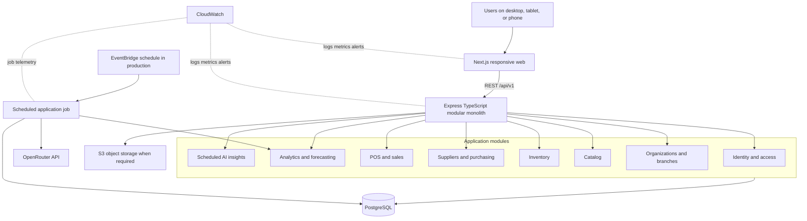
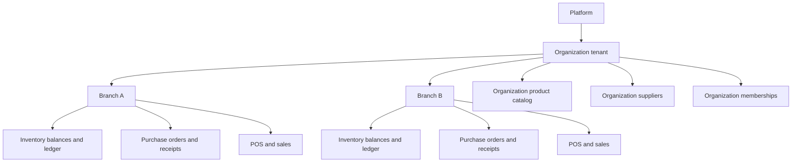
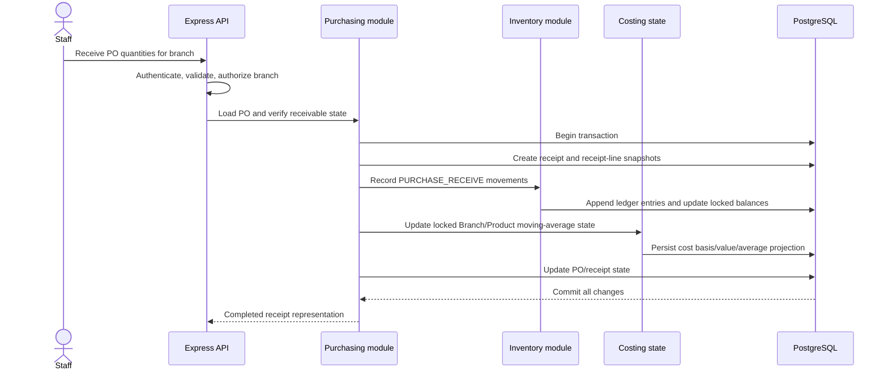
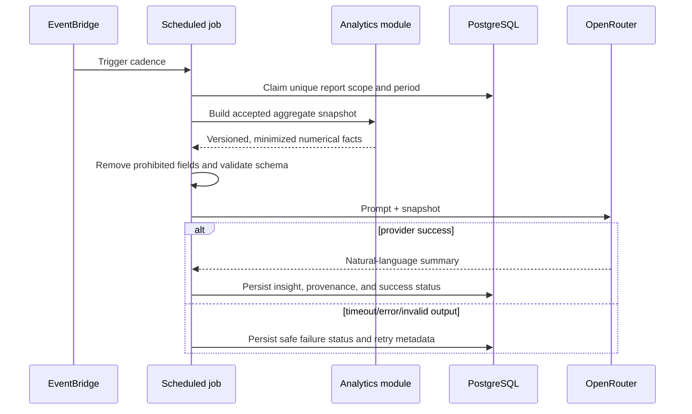
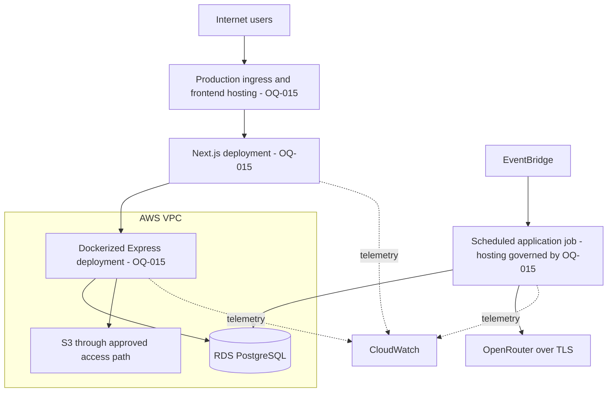
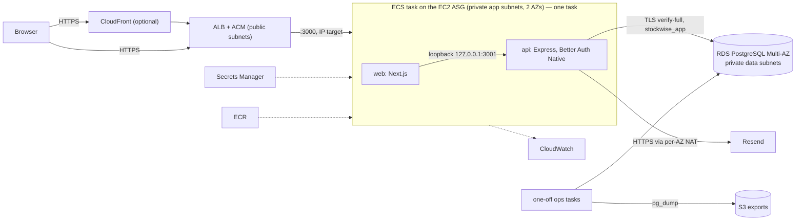

# StockWise Architecture

| Field | Value |
| --- | --- |
| Status | Architecture Freeze v1; application functionality implemented through Phase 7; final acceptance with explicit MT-L04 verification limitation; PRE-CLOUD READY YES; Phase 8 STARTED for the Learner Lab demo only (`ADR-040`, superseding `ADR-039`; infrastructure source implemented and verified locally, nothing provisioned) |
| Baseline | Architecture Freeze v1 |
| Last updated | 2026-10-08 |

## 1. Scope and authority

This document is the Source of Truth for system boundaries, component responsibilities, data flows, module dependency rules, tenancy, and conceptual deployment. Product requirements are owned by `BUILD_SPEC.md`; physical tables by `docs/architecture/DATABASE.md`; formulas by `docs/contracts/ANALYTICS.md`; and HTTP contracts by `docs/contracts/API.md`.

The repository layout is accepted by `ADR-011`. The exact production hosting topology (`OQ-015`) remains unresolved; `ADR-040` (superseding `ADR-039`) accepts a demo-only AWS Academy Learner Lab topology and does not resolve production `OQ-015`. Diagrams below are logical, not a claim that infrastructure exists.

## 2. Architecture summary

`ADR-042` narrows INVENTORY_STAFF to Inventory operations and inventory-relevant
non-cost analytics, removing Catalog/Supplier/Purchasing/Forecast access. Inventory
already owns its required product projection. A separate allowlisted Demo Insight
read path composes existing analytics and Reorder calculations with deterministic
bilingual text; it does not contact OpenRouter, persist provider executions or add
a scheduler. The genuine scheduled/persisted AI workflow remains unchanged.

StockWise is a TypeScript modular monolith with two primary runtime applications:

- A responsive Next.js web application
- An Express REST API containing explicit business-domain modules

PostgreSQL is the system of record. Prisma owns application data access and migrations. Deterministic analytics and forecasts run in TypeScript/SQL. Scheduled jobs build aggregate snapshots and call OpenRouter only for natural-language summaries.



The Next.js/Express applications, operational probes, local PostgreSQL/Prisma foundation, identity/access lifecycle, Catalog and Supplier persistence/API/UI, branch inventory balance/history/manual adjustment, Purchase Orders and Receiving, POS/checkout, Sales History/detail/browser receipt, and linked refunds with optional same-branch restock are implemented. Phase 6 includes deterministic Sales/Category/Branch/Inventory Analytics, Forecasting and Reorder API/UI, and the synthetic demo dataset. Phase 7 includes immutable aggregate snapshots, the OpenRouter provider and minimized prompt layer, idempotent insight generation/persistence, callable cadence orchestration, and persisted insight API/dashboard delivery.

Phase 7 is COMPLETE and PRE-CLOUD READY YES under final acceptance with the explicit MT-L04 verification limitation. Historical MT-L04 remains BLOCKED; native layout/clipping/scaling/pagination/blank-page behavior remains unverified. Post-Phase-7 maintenance/UI tasks do not reopen Phase 7. Phase 8 is started only for the time-limited Learner Lab demo under `ADR-040`; its infrastructure source exists but no AWS resource is provisioned. The runtime timer, cloud scheduling and production deployment remain unimplemented.

### Public and application navigation

The Next.js public routes `/` (marketing) and `/pricing` (pre-launch plan
presentation) use a public header/footer without loading access context or
rendering the application sidebar. They remain public when a user is signed in.
Features are a homepage section, not a separate route. Calls to action use the
existing `/register` and `/login` routes; verification, invitation, recovery,
and `/onboarding` behavior is unchanged.

The existing application shell continues to resolve authenticated organization
and branch navigation for `/app` and its module routes. Authenticated `/login`
still opens the resolved workspace. Pricing is informational only: approved
pre-launch Starter/Growth/Business monthly/yearly proposals and a custom-quotation
Enterprise option grant no subscription, billing, quota, support, or entitlement
state. Exact proposed amounts and allowances are owned by `BUILD_SPEC.md` §5.1.
Enterprise contact activation requires an owner-verified destination; none is
configured. No new API or checkout is introduced. Public marketing copy uses the
existing English/Thai provider through client presentation components, while
server page wrappers retain metadata and prerendered English. Shared preference
buttons toggle Light/Dark (from the resolved theme) and English/Thai directly,
preserving existing provider storage. Public-route browser tests can run with
`pnpm exec playwright test --config playwright.public.config.ts` after a web
production build, without API/database setup.

### Self-profile maintenance

`/app/profile` uses the existing shell, EN/TH provider and theme components.
It is account-scoped, not tenant-scoped, and remains available without an
organization membership. Express owns `GET /me` and `PATCH /me/profile`;
the existing selected authentication middleware supplies the trusted actor
for both Legacy and the non-live Native composition. The module updates only
the existing User display name/phone with atomic optimistic concurrency.
Shared access-context actor data refreshes after save. Session reconciliation
continues to clear private queries, hide private content and revalidate authority.
One route-owned unsaved Profile/Organization Settings form may survive only a
soft focus/visibility reconciliation in memory, and only after fresh actor and
effective organization/role/branch authority match. Logout, session hints, 401,
failed access checks, authority changes and route departure discard that handoff.
No browser storage or general private-data cache is used. Browser Back/Forward
is not intercepted; internal-link/unload warnings are not a history blocker.
No new auth authority, schema, dependency or live cutover is introduced.

`/app/organization-settings` resolves its selected organization from validated
access context and is OWNER/ADMIN-only UX. Express independently enforces
`organization-settings.manage` and the name-only ADR-037 GET/PATCH contract,
including locked mutation-boundary authorization and atomic optimistic versions.
Successful save refreshes shared organization navigation names without changing
session, branch selection or URL context. EN/TH and theme providers are reused.
Organization has no business phone/address columns; Branch Settings remains
the owner of individual-branch contact information.

### Thermal Sale receipt

`P7-POST-M5-T01` shares one `SaleReceipt` presentation between the completed POS
checkout and Sales History detail/reprint. Both existing API projections provide
immutable Sale/item/payment/business/branch/cashier snapshots; the frontend adapts
their field names without recalculating economics or reading current Catalog prices.
Exact strings use the central monetary formatter. Existing quantity strings and UTC
timestamp conventions are retained. Subtotal, optional discount/taxable amount, VAT,
total, CASH tender/change and optional manual TRANSFER reference come from Sale data.
Internal costs and linked refunds remain outside the receipt.

Both flows expose an on-screen preview and `window.print()`. Receipt-scoped print CSS
removes unrelated chrome/controls from layout and resets its ancestors, so hidden
application content cannot create paginated whitespace. The primary preset is 80 mm
paper, 4 mm margins and a 72 mm content width, with 10 pt text, safe wrapping, item
break avoidance and a kept-together totals/payment group. CSS uses an 80 × 297 mm
paged fallback because page size requires two dimensions; the receipt has no fixed
height and long sales paginate naturally. Operators select the driver's 80 mm paper
size, 100% scale and disable browser headers/footers. No direct printer protocol or
printer-profile system is introduced.

After a production web build, receipt/label browser checks reuse
`pnpm exec playwright test --config playwright.labels.config.ts` with controlled API
responses and no database. DOM/CSS, print invocation, responsive screenshots and
headless PDF are software evidence. Native browser print preview remains UNVERIFIED
pending human-assisted `P7-POST-M5-T02`; physical thermal printing remains UNVERIFIED.
Historical MT-L04 and the accepted Phase 7 checkpoint are unchanged.

### Catalog barcode labels

Catalog labels reuse the existing optional Product barcode under `ADR-022`,
distinct from canonical SKU. No additional attribute, migration, API endpoint,
or scan-identifier fallback exists. The existing organization/barcode unique
index and authorized exact-barcode POS query remain the lookup foundation.

Each catalog product exposes a saved-data label preview with quantity 1–100,
native dialog keyboard/focus behavior, and browser-native printing. JsBarcode
encodes Code 128; React renders its binary output as black SVG bars on white,
with ten-module quiet zones. Labels contain product name, the exact barcode
value, and SKU only when distinct; they omit price and stock information.

The generic A4 sheet preset uses 10 mm page margins, at least 100 × 50 mm
labels, 4 mm label padding, and 0.33 mm modules. Long symbols expand the label
up to 190 mm rather than compressing bars. Names/values wrap, labels avoid page
splits, and the print portal removes application chrome from layout. Print at
100% scale with browser headers/footers disabled. This is a sheet-label workflow,
not a printer-specific roll template.

Storage continues to permit the accepted Unicode identifiers up to 128
characters. The Code 128 presentation supports printable ASCII and refuses
symbols wider than the preset, with an explicit error and disabled print;
it never rewrites, substitutes, or restricts the persisted identifier. No GS1
ownership, manufacturer UPC/EAN validity, scanner/device, or physical print
verification is implied. Native print-preview behavior requires direct review;
automated printable DOM/CSS and headless PDF checks are supporting evidence.

Browser checks with stubbed API responses can run without a database via
`pnpm exec playwright test --config playwright.labels.config.ts` after a web
production build. The real catalog E2E also covers the label workflow and
requires an explicitly supplied guarded `TEST_DATABASE_URL`.

### Repository boundaries

The native pnpm workspace uses these physical boundaries:

```text
stockwise/
  apps/
    web/                 # Next.js App Router application under src/app
    api/                 # Express modular monolith
      src/modules/       # Business modules remain inside the API application
      prisma/            # API-owned Prisma schema and migrations
  packages/              # Deliberately shared internal packages only when justified
  docs/                  # Architecture and technical Source of Truth documents
  tests/e2e/             # Cross-application end-to-end tests
  infra/                 # Future deployment/infrastructure configuration
```

Only `apps/*` and `packages/*` are package-manager workspaces. Tests should normally be colocated with their owning application or module; `tests/e2e` is reserved for cross-application workflows. `packages` must not become a catch-all shared layer, and no package is created there without a concrete consumer and dependency rationale. The scheduled job remains an API application entry point unless a later accepted ADR demonstrates a separate deployment need.

## 3. Architecture style: modular monolith

The backend is one deployable application divided by business capability. Modules have owned responsibilities and expose deliberate application interfaces. They do not become separately deployed services.

### Why this style

- The project and team are small enough that service orchestration would add cost without proven benefit.
- Checkout and receiving need strong transactions across sales/purchasing and inventory.
- Domain boundaries are still evolving.
- One TypeScript backend keeps deployment, security, logging, and local development manageable.
- A well-factored modular monolith preserves future extraction options if a measured scaling or ownership need emerges.

### Rules

- HTTP routing is an adapter, not the home of business rules.
- Module-owned application services coordinate use cases.
- Persistence queries must include trusted tenant/branch scope.
- Cross-module writes are coordinated by explicit use cases and one database transaction where atomicity is required.
- Domain modules may depend on small stable contracts; they must not import another module's internal repositories or controllers.
- No module may call another StockWise module over HTTP inside the same application.
- Adding a separately deployable service, queue, or second language requires an accepted ADR.

## 4. Logical component responsibilities

| Component | Responsibilities | Must not do |
| --- | --- | --- |
| Next.js web | Responsive UI, navigation, accessibility, local interaction state, TanStack Query server state, render charts, send validated user intent | Establish trusted tenant scope, calculate authoritative price/totals, mutate stock directly, call OpenRouter |
| Express API edge | Route `/api/v1`, authenticate, validate with Zod, authorize, invoke use cases, map errors, emit request telemetry | Contain domain calculations in controllers, trust client totals/scope |
| Identity and access | Email/password identity, Argon2 verification, opaque PostgreSQL-backed sessions, provider-abstracted verification/reset/invitation email, organization membership, branch assignment, fixed RBAC policy | Infer access from client-provided IDs or couple auth-domain behavior directly to Resend |
| Organizations and branches | Tenant lifecycle, branch lifecycle, active/allowed scope resolution, authoritative sales VAT status/rate configuration | Own product, sale, or inventory business rules; accept checkout-authored VAT authority |
| Catalog | Organization products/categories, SKU/barcode rules, accepted master-data lifecycle, one immutable base unit, and organization-level base price data | Hold branch inventory as `product.stock`, cost/valuation authority, branch-price overrides, or rewrite sale history |
| Inventory | Branch balances, append-oriented signed-delta ledger, adjustments, no-negative stock availability, movement history | Change balances without ledger records; permit a negative-stock override; implement generic audit logging |
| Suppliers and purchasing | Organization suppliers, branch-targeted purchase orders, receipt lifecycle | Update inventory outside an atomic receiving use case |
| POS and sales | Server-side cart validation, exact document totals/allocations, atomic completed Sales, immutable line/payment/VAT/COGS snapshots, history, and Sale-backed receipt views; reversal only after rules are accepted | Trust prices/totals/VAT authority from browser; persist a Draft Sale; commit a partial checkout; rewrite original Sale facts for reversal |
| Analytics and forecasting | Accepted metric formulas, period boundaries, branch/organization aggregation, deterministic forecast and evaluation | Ask an LLM to calculate or forecast; invent unresolved formulas |
| Scheduled AI insights | Snapshot creation, minimization, prompt version, provider call, idempotency, persistence, retry/failure status | Query raw database through OpenRouter; block core workflows |
| PostgreSQL | System of record, constraints, transactions, indexes, balances, ledgers, snapshots, persisted insights | Serve as an authorization substitute without scoped queries |
| S3 | Object assets only when required, such as product images or generated report assets | Store transactional truth that belongs in PostgreSQL |
| EventBridge | Production cadence trigger for scheduled report work | Define business-period semantics |
| CloudWatch | Operational logs, metrics, dashboards, and alerts | Receive secrets, raw passwords, or unnecessary personal data |
| SQS (conditional) | Buffer background work only after measured need and accepted ADR | Be a default dependency or source of transactional truth |

## 5. Tenant and branch boundaries



### Accepted invariants

1. `Organization` is the tenant boundary.
2. `Branch` belongs to one organization.
3. Product/category/supplier belongs to one organization.
4. Inventory balance/transaction, purchase order/receipt, and sale/payment belongs to one branch.
5. A branch-owned record's organization must equal the organization of every organization-owned resource it references.
6. A user can have organization-wide access and/or access to multiple branches.
7. An organization aggregate is computed only from branches visible to the actor.
8. Background jobs execute with an explicit organization and report scope, not an unrestricted global query accidentally reused from request code.
9. Catalog persistence carries `organization_id` on Category and Product; a Product's nullable Category relation uses a composite Category/organization foreign key, so PostgreSQL rejects cross-tenant references independently of application code.
10. Inventory persistence carries `organization_id` on both balance and ledger rows,
    uses composite Branch/Product tenant foreign keys, and binds ledger actor
    membership to the same organization and actor user at the database boundary.

### Trusted request context

Conceptually, the API establishes:

```text
Authenticated actor
  + verified organization membership
  + verified branch assignment when branch-scoped
  + role permission for action/resource
  = authorized request context
```

Path/query/body fields select a candidate resource; they never grant access. Cross-tenant records should be reported without revealing their existence.

P3-M1-T03 applies that boundary to the organization-owned catalog. Catalog
routes accept optional query `branchId`: `OWNER`/`ADMIN` may use organization
scope without it, while branch-scoped roles must provide an active branch that
the API re-resolves with an effective active assignment. Supplied branch IDs
are candidates only; missing required context is distinct from the common safe
forbidden result used for nonexistent, inactive, cross-tenant, unassigned, or
revoked context. Catalog controllers never accept role, membership, assignment,
permission, actor, or tenant ownership as client authority.

### Application context and branch cache boundary

`GET /api/v1/me/access-context` returns only active memberships and currently
effective active branches. `OWNER`/`ADMIN` receive every active branch in the
organization; branch-only roles receive only active explicitly assigned
branches. It also returns a server-derived first-organization onboarding
eligibility boolean computed from all membership statuses and durable onboarding
provenance. The response is safe display/navigation data, not a permission token,
and first-organization creation independently rechecks eligibility inside its
transaction.

The Next.js application uses only `/app?organizationId=<id>&branchId=<id>` for
selection. Each load resolves those candidates against the newest access
context, chooses the first code-ascending effective branch when a candidate is
missing or revoked, and replaces the URL with the canonical result. A switch or
revocation cancels and removes the old TanStack Query prefix
`["branch-scoped", organizationId, branchId, ...]` before transition so cached
data from the prior branch cannot render as current. A zero-organization context
enters first setup only when the server eligibility flag is true; otherwise it
renders the safe no-access state.

### Authorization policy convention

P2-M1-T03 establishes the API-owned, pure policy foundation at
`apps/api/src/modules/identity/authorization-policy.ts`. It owns the fixed
typed permission vocabulary, server-resolved authorization context, trusted
organization/branch resource scopes, and the centralized `can(context,
permission, resourceScope)` decision. It issues no database query and is not
itself a database service. Protected branch and membership use cases resolve
trusted state from PostgreSQL and call this policy before mutation or exposure.

- A trusted context is constructed only from server-resolved actor,
  membership, and branch-assignment state. It retains the actor and membership
  identities, active/disabled states, organization role, and active assigned
  branch IDs; actor/membership or assignment organization mismatches fail
  closed.
- A trusted branch scope carries both the requested organization and the
  branch's resolved owning organization. A mismatch fails before a role can
  receive organization-wide or branch-assignment access.
- `OWNER` and `ADMIN` may use organization scope and every branch in their
  organization. `BRANCH_MANAGER`, `INVENTORY_STAFF`, and `CASHIER` must use an
  actively assigned branch scope; organization scope and zero or inactive
  assignments deny access.
- The vocabulary includes the accepted catalog, supplier, inventory,
  purchasing/receiving, checkout, sales-history, refund, analytics, forecast/reorder,
  AI-summary, and governance capabilities. `ADR-028` adds refund create/view/cost-view
  authority and deliberately adds no VOID capability. `ADMIN` can manage only non-owner memberships;
  OWNER membership, ownership transfer, and destructive ownership actions are
  OWNER-only. Membership mutations serialize on the organization row and
  preserve the last-active-OWNER invariant.

## 6. Critical data flows

### 6.1 Authentication and scope selection

`ADR-034` is implemented by T02A's synchronized schema/backend/security
cutover. T02A-AUTH-VERIFICATION-WEB-01 implements the web OTP/link continuation and password-proof fallback; independent frontend acceptance and scoped local frontend/backend/PostgreSQL integration final review are accepted (2026-10-10); external email delivery and production HTTPS remain unverified.
Historical P2 registration-without-delivery and link-only verification are
no longer backend compatibility paths. Ordinary application authentication,
onboarding, authorization, invitations, and reset eligibility retain their
existing boundaries.

Identity owns three distinct security concepts:

| Concept | Responsibility | Authority boundary |
| --- | --- | --- |
| Application session | Existing opaque `stockwise_session` plus hash-only PostgreSQL `Session` | Authenticates an ACTIVE verified actor; authorization separately resolves scope |
| Verification password-proof context | Short-lived encrypted cookie proving installation/knowledge of one password version | No Session, `TrustedAuthenticationContext`, tenant, role, or protected-API access |
| Mailbox verification challenge | Unified OTP/link proving mailbox possession | Never authenticates independently; requires matching password proof to verify |

The API must require `proof.subject = challenge.userId = user.id` and
`proof.credentialVersion = challenge.credentialVersion = user.credentialVersion`
while locking an ACTIVE unverified user. `User.credentialVersion` is positive,
monotonic, initially `1`, and advances with every committed password change.
Mailbox possession alone must not activate an attacker-installed pending
password. Verification consumes the shared challenge and sets `emailVerifiedAt`
atomically, then directs the user to **Sign in**, never creating a session.

Registration preserves canonical email, exact password/Argon2id policy, its
five-per-15-minute limiter, generic `202`, and database uniqueness. All permitted
valid paths hash before eligibility lookup. Initial creation installs version
`1`, a matching challenge, and real proof; admitted ACTIVE/unverified duplicate
replacement atomically advances password/version/timestamp and replaces the
challenge/proof. Known delivery quota/capacity rejection cannot partially replace
a duplicate's credentials. Verified/disabled duplicates do not mutate them.
All generic continuations carry same-shaped selectors and encrypted real/phantom
proof cookies. Initial delivery suppression still commits the legitimate account
with a bound revoked challenge and real installation proof; resend recovers it.

Correct-password ACTIVE/unverified login revalidates the password snapshot under
the user lock, returns `verification_required` and real proof, and issues no
Session or `stockwise_session` change. It does not automatically send mail.
Ordinary verified login revalidates the snapshot before existing session
creation/rotation and returns the existing safe actor shape. Missing accounts
retain fixed-dummy Argon2 verification; wrong/disabled outcomes stay generic.
The dedicated password-proof fallback shares login's failure budget and cannot
create sessions, challenges, or mail, even for a now-verified account.

The challenge has six uniform ASCII digits and a separate 32-byte random link,
one ten-minute expiry, and five durable wrong OTP comparisons. OTP uses a
dedicated-secret HMAC with bound user/challenge/version and constant-time
comparison; link storage remains SHA-256 only. OTP exhaustion becomes
`LINK_ONLY`; link success still consumes both. Resend atomically replaces mailbox
material only and never creates, clears, refreshes, or upgrades password proof.
Validate mailbox material before exposing proof-required errors; wrong OTP
comparisons count even when proof is absent. There is no status/proof oracle.

The proof is stateless AES-256-GCM under its own key, absolute ten minutes with
no sliding refresh, carried only in `__Host-stockwise_verification_proof`
(`HttpOnly`, always `Secure`, `SameSite=Strict`, `Path=/`, no `Domain`).
Encrypted real/phantom claims hide eligibility. No proof table, JWT, browser
storage credential, or replay cache. Key/codec/rotation rules are owned by
`ADR-034`; live user/version/challenge checks constrain replay. Cookie clearing
is not global revocation of stateless copies. Tabs share one cookie; independent
devices can prove the same version. Local compatibility must be browser-verified
or use HTTPS, never weaken `Secure`.

Use cases depend on `IdentityEmailProvider`, not a provider SDK. Preserve
Resend/non-delivery/test adapter selection. Registration and resend share the
three-per-15-minute delivery budget; bounded dispatch reservation precedes
duplicate replacement. Verification delivery occurs after commit and response
completion, with at most 32 outstanding process-local reservations, ten-second
timeout, no queue/outbox/automatic retry, and exact-challenge compensation.
Provider failure never rolls back the password or revives a predecessor.
Crash-window mail loss is recoverable by resend, not a delivery guarantee.

Password/verification/reset operations lock user first, challenge/token second,
reread after locks with fresh database time, and never hold locks during Argon2
or provider calls. Reset remains ACTIVE/verified-only, rejects invalid token
state before Argon2, and atomically consumes its 30-minute token, updates
password/timestamp/version, invalidates verification material, and revokes all
sessions; it creates none.

The API contract owns exact envelopes, mailbox-first errors, and strict
same-origin JSON/Origin/Fetch Metadata protections. Frontend continuation stores
only noncredential email/selector/version/time (at most 30 minutes); normal
register/login reaches OTP without re-entry. Missing/stale proof offers current
password inline; browser reopen recovers through Login. Token-bearing verification
GETs stop at a token-free, non-hydrating frontend document boundary. The browser
captures the query credential in a one-use memory handoff, scrubs URL/history,
then loads the clean Next.js document so the token cannot enter serialized
App Router/hydration state. The verification component retains it only in memory
for explicit POST consumption; reload/abandonment/pagehide discard it. Both
documents preserve no-referrer/no-store. All web documents deny framing through
CSP `frame-ancestors 'none'` and `X-Frame-Options: DENY`, including SPA entry
routes. Resend commits require the current mounted request and unchanged
continuation revision/identity, even if cancellation races with completion.
Existing Light/Dark, EN/TH, and accessible shadcn/ui direction remain.
Independent web acceptance and scoped local real frontend/backend/PostgreSQL integration review are accepted; external email delivery and production HTTPS remain unverified; cloud-wide abuse/delivery
guarantees are not implied.

P2-M3-T01 adds one authenticated first-organization command at
`POST /api/v1/organizations`. The Express boundary accepts only the six profile,
organization, and initial-branch fields, applies accepted canonical trimming,
and hashes their deterministic canonical representation internally. The use case
locks the platform user row, re-evaluates unique onboarding provenance and every
membership status inside one PostgreSQL transaction, and either replays, rejects,
or atomically updates the profile and creates the organization, `OWNER`
membership, `MAIN` branch, and provenance row. The provenance branch uses the
existing composite branch/organization identity; the client supplies no actor,
tenant, role, branch code, or authorization state. OWNER remains organization-
wide and receives no assignment. The web form uses the same-origin Express path
and navigates success only to the minimal `/app` holding shell.

P2-M3-T03 keeps membership governance in the identity module and wires the
central policy into authenticated Express routes. Invitation creation locks the
organization, validates delegation and the complete active same-tenant branch
scope, replaces any prior open invitation, stores only a fresh token hash, and
delivers the transient `/accept-invitation` URL through the existing provider.
Provider failure conditionally revokes only that new invitation.

Acceptance resolves a hash candidate, then locks the organization and
invitation in that order. It revalidates lifecycle, canonical actor email, and
branch state before atomically creating membership/assignments, consuming the
invitation, linking `sourceInvitationId`, and recording the bounded access
event/scope snapshot. Concurrent same-token acceptance reconciles to one
logical result; revoke and reissue use the same lock order. Role/scope edits,
deactivation, and reactivation are exact-version full replacements under the
organization lock. Deactivation leaves sessions and configured assignments
intact but authorization/access-context re-evaluation immediately removes the
membership. `/app/members` is management UX only; the API remains authoritative.
Invitation tokens remain URL-transient and are never copied to browser storage.

The browser never receives a JWT or refresh token and never stores an auth token in `localStorage` or `sessionStorage`. Session expiry/revocation and disabled actors are evaluated server-side; deauthorized membership is denied later by the separate authorization boundary. The cookie has `Path=/`, is host-only, `SameSite=Lax`, and `Secure` in production but not local HTTP. Configurable timeout baselines are sliding 24 hours idle, fixed seven days absolute, and a 15-minute minimum persisted-touch interval.

#### Better Auth pre-cutover transition boundary

ADR-035/036 and owner-approved D5-P3 DEC-01/02/03 retain StockWise User UUIDs,
tenant/branch relationships and RBAC. The accepted transition writer
(`native-auth-transition.ts`) transfers only validated eligible Legacy PHCs into
missing canonical Native accounts. A durable PostgreSQL singleton fences Legacy
authentication/writers with one-way LEGACY/QUIESCED/NATIVE state; append-only
generation-bound enrollment provenance makes exact retry a no-op and changed-state
retry a conflict. No runtime startup or HTTP route invokes the writer; only the
receipt-bound disposable rehearsal tool and the explicitly confirmed operator
command (`native:cutover`) construct it.

D5-P5 (in progress; Codex acceptance pending) selects the authority at runtime
with `STOCKWISE_AUTHENTICATION_AUTHORITY`: production is Native-only (`ADR-039`
D-03R), and local development/test default to Legacy. Native requires the D5-P4
sealed-NATIVE preflight; Legacy refuses any database whose fence has left LEGACY.
Each process constructs exactly one authority and never falls back.
The D5-P4 source startup gate reads shipped migration checksums and one consistent
read-only database snapshot before a future Native listener can open. It requires
sealed authority, enabled fence triggers and reconciled credential generations;
it never runs the transition writer or falls back to Legacy. Existing UUID/business
preservation is established by the transition's pre-seal reconciliation, not by
comparing mutable business rows to that frozen snapshot on every restart.

Database draining, Legacy authority invalidation and whole-business-row
reconciliation precede database Native authority in the owned rehearsal. Native
credential changes require forward recovery, never stale Legacy fallback.
Deployment still requires independently verified ingress/request drain, least
privilege, encrypted backup/restore and latest-authority reconciliation; a database
backup can also roll back its fence. No production RPO/RTO or Live authorization
is inferred from disposable proof. See
[`BETTER_AUTH_MIGRATION.md`](../development/BETTER_AUTH_MIGRATION.md).

### 6.2 Manual inventory adjustment

An authenticated adjustment re-resolves and holds trusted Organization, actor,
Branch, Product, membership, and assignment state for one PostgreSQL transaction.
After exact signed-delta validation, it takes a deterministic organization/key
transaction advisory lock, resolves replay or conflict from the durable ledger,
then takes a deterministic Branch/Product transaction advisory lock. The latter
serializes the lazy missing-row case; an existing `InventoryBalance` is also read
`FOR UPDATE`. The service computes with Prisma Decimal, rejects a negative result,
updates or creates the balance, and appends one `MANUAL_ADJUSTMENT` movement before
commit. Any failure rolls both writes back.

The two advisory-lock classes use SHA-256-derived signed 64-bit keys in disjoint
positive/negative namespaces. A same-class key collision can only serialize
unrelated operations; tenant keys and database uniqueness still determine business
identity. Every adjustment acquires idempotency before balance locks, so identical
and conflicting retries share one lock order. No raw idempotency key or client actor
provenance is persisted.

### 6.3 Purchase receiving



P4-M3-T01 implements this flow behind a service boundary and one PostgreSQL transaction; P4-M3-T02 exposes that service through the authenticated, CSRF-protected receive command without duplicating domain writes. One `ORDERED` PO produces at most one all-at-once immutable receipt; receipt quantities are server-derived from frozen lines; and `DRAFT` → `ORDERED` → `RECEIVED` / `CANCELLED` is the accepted lifecycle. Partial/over/short/multiple receipt, discrepancy handling, receiving without a PO, supplier returns, receipt correction, and receipt reversal are excluded.

Costing is implemented as a Branch/Product projection owned separately from Product catalog data. Receipt `actualUnitCost` is the authoritative intake; PO `expectedUnitCost` remains planning/history data. A first receipt initializes a previously `UNKNOWN` Branch/Product basis for all then-on-hand quantity without inventing or backfilling historical acquisition cost. Before that initialization, cost-dependent valuation/COGS remain unavailable rather than zero. Known-basis manual adjustments use the retained average; reaching zero forces value to zero while retaining that average. Any validation, authorization, state, cost, quantity, or database error rolls back the complete operation.

### 6.4 POS checkout

```mermaid
sequenceDiagram
    actor Cashier
    participant Web
    participant API as Express API
    participant Sales
    participant Inventory
    participant DB as PostgreSQL

    Cashier->>Web: Submit transient cart and payment intent
    Web->>API: POST checkout with idempotency key
    API->>API: Authenticate, validate, authorize branch
    API->>Sales: Invoke checkout with validated intent
    Sales->>DB: Begin transaction
    Sales->>DB: Claim/resolve checkout idempotency
    Sales->>DB: Lock VAT profile; re-load products and exact prices
    Sales->>Sales: Compute document totals and deterministic allocations
    Sales->>DB: Lock sorted Branch/Product balances and cost states
    Sales->>Sales: Enforce stock, discount, VAT, payment, and cost rules
    Sales->>DB: Create Sale, line snapshots, and one Payment
    Sales->>Inventory: Record negative SALE movements
    Inventory->>DB: Append ledger, update balances/cost state
    DB-->>Sales: Commit all changes
    Sales-->>API: Stable sale/receipt response
    API-->>Web: Return same result on safe retry
```

`ADR-027` keeps the mutable cart client-side: no Cart, Draft Sale, or inventory
reservation is persisted. Existence of a Sale row means the checkout transaction
completed successfully; the initial model has no Sale status. Product `basePrice` is
server authority and `expectedUnitPrice` is only an exact optimistic price-change
precondition. The checkout uses THB, one CASH or manually confirmed TRANSFER Payment,
an optional manager-or-higher whole-Sale AMOUNT/PERCENT discount, and a
server-generated immutable `SALE-<UUID>` reference. Sale/SaleItems/Payment are the
receipt source; there is no separate Sales Receipt aggregate or Customer/CRM data.

Organization owns authoritative sales VAT application configuration:
`UNCONFIGURED`, `NOT_REGISTERED`, or `REGISTERED` plus a nullable configured rate.
`UNCONFIGURED` blocks checkout and is not a legal registration classification. A
REGISTERED MVP Organization treats every POS Product as subject to its single rate and
`basePrice` as VAT-inclusive. Discount precedes document-level VAT extraction. A
NOT_REGISTERED Sale has null taxable amounts/rate snapshot and zero Output VAT.
Mixed/product-specific/exempt/zero-rated/multiple-rate tax behavior and a jurisdiction
tax engine are outside MVP.

Document totals use exact Decimal arithmetic, `ROUND_HALF_UP` at the accepted
persisted boundary, and deterministic largest-remainder cent allocation with Product
ID tie-break. Non-negative line allocations enforce discount no greater than gross,
VAT no greater than net, and non-negative net/taxable amounts; line sums must equal
their Sale subtotal, discount, total, taxable, and Output VAT facts as applicable.

Checkout acquires organization/operation idempotency before the existing shared
Branch/Product serialization keys in sorted Product-ID order, then locks balances and
cost states. It atomically creates Sale/SaleItems/one Payment, negative `SALE` ledger
movements, balance changes, cost-state changes, COGS snapshots, and the replay result.
No-negative stock follows `ADR-024`. KNOWN cost retains the accepted moving average.
UNKNOWN cost remains UNKNOWN with null average/value and null SaleItem unit cost/COGS
whether remaining quantity is positive or zero; later receipt initialization never
backfills history. Any failure rolls back every checkout effect.

The POS barcode input is a product-selection shortcut over the existing authenticated
`GET /api/v1/organizations/{organizationId}/branches/{branchId}/pos/products`
barcode query. Manual entry and USB/Bluetooth keyboard-emulation scanners use a
visible, labelled field with Enter submission; ordinary typing elsewhere is not
intercepted. Each submission performs a fresh exact lookup without the text-search
filter. A FIFO queue serializes lookups, retains repeated intentional scans, bounds
each lookup to 15 seconds, and aborts pending work when the POS scope changes or
unmounts. Checkout waits for the queue and any open camera dialog. Available results
use the existing cart-add path: one Product line, increment by one on repeated
selection, retaining the original cart price precondition. Missing/unavailable
results and lookup failures leave the cart unchanged and expose safe recent-scan
feedback. Organization/Branch scope and final stock, price, quantity, VAT, payment,
and idempotency rules remain backend authority.

Camera scanning starts only after the operator opens the native modal dialog and
requests video only, preferring the rear-facing camera. It requires HTTPS or
localhost and browser camera access. Native `BarcodeDetector` is used only when it
supports Code 128, EAN-13, EAN-8, UPC-A, and UPC-E; a lazily loaded ZXing browser
one-dimensional reader supplies local decoding when native support is absent,
partial, or fails. Frames stay on the device and are neither recorded nor uploaded.
Camera mode accepts one detected value per opening, stops decoding and all media
tracks before submitting the value to the same queue, then returns focus to the
barcode field. Reopening permits another intentional scan of the same Product.
Close/Escape, navigation/unmount, errors, and backgrounding also release resources,
including streams granted after cancellation. Permission, missing-device, busy
camera, unsupported-browser, and insecure-context feedback preserve USB/manual
entry. Camera symbologies do not restrict or transform stored Product barcodes.

### 6.5 Sale refund

```mermaid
sequenceDiagram
    actor Manager
    participant Web
    participant API as Express API
    participant Sales
    participant Inventory
    participant DB as PostgreSQL

    Manager->>Web: Submit item refund/restock quantities, reason, payment evidence
    Web->>API: POST Sale refund with Idempotency-Key
    API->>API: Authenticate and validate strict intent
    API->>Sales: Invoke refund for candidate Sale scope
    Sales->>DB: Begin transaction; lock refund idempotency
    Sales->>DB: Revalidate access; lock original Sale
    Sales->>DB: Load original snapshots and prior refunds
    Sales->>Sales: Enforce cumulative quantity and derive money/VAT/cost
    Sales->>DB: Create refund/items and one matching-method payment
    Sales->>Inventory: Restock only positive restock quantities
    Inventory->>DB: Lock sorted products; append return ledger; update balance/cost
    Sales->>DB: Persist replay result and commit all changes
    Sales-->>API: Immutable linked REFUND
    API-->>Web: Return same result on identical retry
```

`ADR-028` adds one linked REFUND concept and no VOID concept. The original
Sale/SaleItems/Payment, negative `SALE` movements, receipt, and historical snapshots
remain immutable. Each refund item has a positive financial quantity and a separately
recorded restock quantity from zero through that amount. Only restock creates a
positive `SALE_REFUND_RETURN` movement in the original active Branch.

Refund money, discount, VAT, taxable value, and COGS derive from cumulative original
SaleItem snapshots; current Product price/VAT configuration/current average never
rewrites history. Returned KNOWN-cost units enter at original unit cost. Mixed UNKNOWN
cost conservatively remains/becomes UNKNOWN except a known-cost return into zero
UNKNOWN quantity may initialize KNOWN. One matching-method manual RefundPayment and
all optional stock/cost effects share the transaction.

Refund concurrency uses Organization idempotency first, then the original Sale row to
serialize cumulative eligibility, then the existing shared Branch/Product locks in
sorted Product-ID order for restock. The API revalidates tenant/branch/role authority
against the persisted Sale. There is no time cutoff, approval chain, gateway, generic
`OQ-019` audit dependency, or dependence on the reporting calendar later fixed by
`ADR-029`.

### 6.6 Deterministic analytics

1. The actor supplies strict local date-only `from`/`to`, granularity, and candidate
   Branch/Organization scope.
2. The API derives active membership/assignments and `BUSINESS_ANALYTICS_VIEW` or
   `INVENTORY_ANALYTICS_VIEW`; cost outputs additionally require `SALES_COST_VIEW`.
3. The period engine loads the Organization IANA timezone and converts aligned local
   day/Monday-week/month/year boundaries to half-open UTC instants with DST rules.
4. One captured event `sourceCutoff` and transactionally consistent read snapshot
   select immutable Sales/refunds/receipts/ledger facts in their own event periods.
   P6-M3-T01 reads mutable current balance/cost state in the same inventory-page
   snapshot and separately labels it `currentSnapshotCapturedAt`; continuation pages
   retain the original event cutoff but capture a new current-state marker. They do
   not reconstruct historical quantity or valuation from current projection rows.
5. SQL performs exact set aggregation; TypeScript applies only accepted Decimal/null/
   coverage formulas and gap-fills canonical buckets.
6. The response includes `analytics-v1`, exact UTC/local period metadata, timezone,
   source cutoff, included authorized Branch scope, completeness, cost coverage, and
   values/null reasons.

`ADR-029` resolves `OQ-011`/`OQ-016`, and `docs/contracts/ANALYTICS.md` exclusively owns formulas
and period semantics. Analytics V1 reads normalized operational tables directly; no
warehouse, OLAP service, stream, materialized view, scheduled rollup, or summary table
is introduced before measured need. P6-M3-T01 uses set-based ledger/balance/cost
queries and reconciles the current projection against all ledger deltas visible in
that same read snapshot; it does not compare current balance to an earlier
event-cutoff subset. P7-M1-T02 persists completed-period Sales aggregates as
immutable, versioned AI input snapshots; P7-M2-T03 implements idempotent insight
generation and persistence over those snapshots.

### 6.7 Scheduled AI insight



Dashboard reads the persisted result. Opening or refreshing the dashboard does not call OpenRouter. `ADR-033` governs V1 schedule times, bounded catch-up, provider, model, budget, and failure behavior.
P7-M2-T02 prepares `ai-business-summary-prompt-v1` transiently from the supported
`analytics-snapshot-v1`/`analytics-v1` Sales payload. Its provider projection uses
only the generic Organization/Branch summary label, cadence, reporting timezone,
persisted local and UTC period bounds, source cutoff, complete status, and the
nine validated Sales fields (including nullable values and reasons). Internal
tenant/Branch/snapshot IDs, names, raw rows, and arbitrary JSON never enter the
prompt. V1 always has available counts and amounts, even for an empty period,
so its all-zero snapshot is not locally insufficient. The output contract is
plain Unicode prose: reject empty, malformed, control-laden, JSON-like,
prompt-marker, or HTML-like text before persistence; the UI must escape
it as text. P7-M4-REM-01 additionally rejects a leading safety-classifier verdict
and requires a Sales metric term from the English vocabulary of the V1 prompt
(sales/refunds/revenue/average order value/COGS/cost/profit/margin/growth).
Invalid prose follows the existing non-retryable `INVALID_RESPONSE` path, with
no persisted summary content; `openrouter/free` routing is unchanged. This
bounded relevance check cannot prove factual accuracy or detect every
invented number; the authoritative snapshot and explicit no-calculation prompt
remain separate controls. Only the prompt version, not its raw text, is
persisted as provenance.
P7-M2-T03 now provides an internal, single-identity report job. It reuses the
immutable AnalyticsSnapshot, pins its schema/metric/source cutoff and prompt
version at claim, and reserves each of at most three provider attempts in
PostgreSQL before network I/O. Completed calls record only safe provenance;
success stores T02-validated plain text. A duplicate observes the existing job.
An expired claim with no reserved call can be reclaimed, while any reserved or
completed provider activity fails closed as `INTERRUPTED` after a crash because
external delivery cannot be proven exactly once. Network I/O never holds a
database transaction open. P7-M3-T02 provides the persisted read-only API, and
P7-M3-T03 provides the dashboard UI.
An internal Branch status-history lookup supplies due-instant eligibility from
immutable events. Pre-migration history is unknown, so Branch generation skips
due instants before its first trustworthy event; Organization aggregation keeps
its existing historical Branch scope.
P7-M3-T01 provides an internal callable cadence orchestrator with an injected
current instant. For each active Organization it uses the ADR-029 timezone and
period engine to select the two most recent due completed periods per cadence,
oldest first, at 06:00 local time. A missing 06:00 fires at the first valid
instant after the gap; a repeated 06:00 uses its earlier occurrence. Cadences
iterate daily, weekly, monthly, yearly; each period runs the Organization job
first, then Branches in ID order. Branch discovery includes currently active
Branches and Branches with lifecycle events since the oldest candidate due
instant; each Branch is then checked against immutable status history at that
period's original due instant. Unavailable history skips Branch generation.
Each candidate invokes the P7-M2-T03 job sequentially, so its persisted identity
controls duplicates and attempt budgets; one failed candidate does not stop
later candidates. The safe run counts distinguish a persisted failed result
from an unexpected execution error. A future local timer or EventBridge trigger
is only a wake-up signal. Its worker supplies the T03 job and current instant;
the orchestrator determines due periods and scopes. T01 creates no cloud trigger
or replay path.

## 7. Data ownership and module interactions

| Owning module | Owns | Authorized collaborating use cases |
| --- | --- | --- |
| Identity/access | Users, memberships, branch assignments, role policy | All modules ask it to establish/check actor scope |
| Organizations/branches | Organization and branch lifecycle | Catalog/inventory/purchasing/sales validate ownership |
| Catalog | Categories and products | Inventory references product; purchasing/sales snapshot product data |
| Inventory | Balance and transaction ledger | Receiving adds; checkout subtracts; approved reversal compensates |
| Purchasing | Supplier, purchase order, receipt | Receiving coordinates inventory and accepted costing |
| Sales | Completed-by-existence Sale, line/payment/VAT/COGS snapshots, checkout idempotency, Sale-backed receipt projection | Checkout coordinates inventory; a later accepted reversal use case creates linked compensating records without rewriting original facts |
| Analytics | Metric queries/snapshots/forecast/evaluation | Reads stable operational data; supplies aggregate AI snapshot |
| AI insights | Insight job/run/output/provenance | Reads validated analytics snapshot only |

Owning a table does not mean bypassing another module's invariant. For example, Sales does not directly decrement an arbitrary balance; the checkout use case invokes the inventory contract inside the same transaction.

## 8. Frontend architecture responsibilities

- Use Next.js and TypeScript for the responsive web client.
- Use TanStack Query for remote server state and cache invalidation.
- Use Tailwind CSS and shadcn/ui for the component system.
- The frontend uses the official shadcn `base-nova` preset with neutral CSS
  variables, Base UI primitives and Lucide icons. Shared forms, actions and
  tables consume generated components; native date inputs and existing domain
  dialogs retain their behavior. Public pages use the same neutral foundation.
- `next-themes` owns class-based Light/Dark/System selection and local
  `stockwise.theme` persistence. A small typed English/Thai dictionary owns
  shared shell/navigation/actions and local `stockwise.language` persistence;
  browser language supplies the initial default, with English fallback and
  updated HTML `lang`. Page-specific copy is not fully translated. Preferences
  do not translate stored domain data or alter identifiers, exact money,
  reporting timezone, API scope or authentication.
- Receipt and barcode-label screen/print content remains white paper with
  dark text regardless of theme. Software print checks do not establish native
  preview or physical printer verification; historical MT-L04 remains BLOCKED.
- Use Recharts for accessible, labeled chart views; provide textual/tabular alternatives for critical numbers.
- Keep authorization enforced on the API even if the UI hides inaccessible actions.
- The shared application shell reads the existing `access-context` query for
  authentication and resolves URL candidates through `resolveApplicationContext`.
  Authenticated desktop navigation uses a persistent left sidebar; smaller
  screens use the official Sidebar's mobile Sheet. Desktop navigation can be
  collapsed off canvas. Home and the StockWise logo target the scoped
  `/app` workspace. Existing role/scope visibility is UX only; Express remains
  authoritative. Log out reuses the current-session logout flow at the sidebar
  bottom. Signed-out navigation retains Sign in without application destinations.
- Treat selected organization/branch as navigation context, not proof of permission.
- Present loading, empty, stale, partial-data, error, and retry states.
- Never compute authoritative checkout prices or analytics in the browser.
- Keep checkout carts transient; render server-returned totals/receipt facts. The later
  POS UI must expose VAT configuration only to `OWNER`/`ADMIN`, block checkout while
  it is unconfigured, and expose discounts only to manager-or-higher roles.
- Do not add a native wrapper or offline mutation queue within the current scope.
- Use the Next.js App Router with the `src/app` directory convention; do not use the Pages Router.
- Keep React Server Components as the default and add `"use client"` only at boundaries that require state, effects, event handlers, browser APIs, or client-only providers.
- Add Route Groups such as `(auth)` or `(app)` only when implemented routes justify them; do not create speculative route structure.
- Keep StockWise core and business REST APIs in the Express application. Do not implement them as Next.js Route Handlers.
- During local development, the browser reaches the Express operational health
  probe through the Next.js same-origin `/api/health` rewrite and Express-owned
  REST endpoints through the same-origin `/api/v1/:path*` rewrite. Both target
  the API's loopback origin and avoid enabling broad browser-to-API CORS. The
  server-only loopback origin never enters a client bundle.

## 9. Backend layering

Within `apps/api`, each module must preserve these responsibilities:

```text
HTTP route/controller
        |
validation + authenticated context
        |
application use case
        |
domain rules / module contracts
        |
Prisma-backed persistence and external adapters
```

- Controllers map HTTP to application input/output.
- Zod schemas validate external shape and basic constraints.
- Application use cases coordinate authorization, transactions, and modules.
- Domain rules express invariant decisions independent of Express.
- Persistence adapters issue scoped queries and translate database errors.
- External adapters isolate OpenRouter, S3, scheduler, logging, and time.

The internal AI provider accepts only already-approved text and returns validated
text, actual model, optional reported usage, and sanitized attempt metadata. Its
OpenRouter adapter has a fixed endpoint and requests `openrouter/free` for every
attempt, with no database access or startup call. It retains the valid routed
model identifier as provenance. OpenRouter's generic HTTP 404 is non-retryable.

Avoid a generic repository abstraction that erases query semantics, tenant scope, locking, or transaction requirements.

## 10. Data consistency strategy

### Strong consistency required

- Checkout and inventory deduction
- Receiving and inventory addition
- Adjustments and balance changes
- Refund/payment/restock compensation under `ADR-028`
- Uniqueness and membership constraints
- Idempotent creation of a sale, refund, receipt, snapshot, and scheduled report
- Document-first Sale monetary allocation and one-payment/receipt consistency

### Derived/read models

- `InventoryBalance` is a transactionally maintained projection of ledger movements.
- Inventory mutation establishes/locks the affected branch/product balance inside a
  PostgreSQL transaction, rejects a resulting negative quantity, then updates the
  projection and appends its immutable signed-delta movement atomically. A missing
  balance represents zero and is created lazily only by a successful first movement.
- Analytics snapshots and AI insights are derived and reproducible from operational truth, subject to versioning and retention rules.
- A stale AI insight is acceptable and must be labeled; a stale or inconsistent stock balance is not.

No event-driven eventual consistency is required for the core MVP flows.

## 11. AWS deployment boundaries

Accepted AWS services define capabilities, not the final topology:



The final design must decide public/private subnets, ingress, Next.js hosting mode, Docker compute, TLS, DNS, secrets, IAM, security groups, backups, multi-AZ, infrastructure as code, region, deployment strategy, recovery, and cost through `OQ-015` and `OQ-020`. The Learner Lab demo answers these for its scope only in `ADR-040`, which supersedes the `ADR-039` topology.

### Learner Lab demo topology (`ADR-040`)

The source lives in `infra/learner-lab`. Its diagram and service-by-service explanation are in `infra/learner-lab/ARCHITECTURE.md`. It is not provisioned.



- **Same trust boundaries as the local design.** The web container is the only target, the API stays loopback-only inside the task's network namespace, and the database is reachable only from task security groups.
- **Exactly one application task.** The login/password-proof limiter is process-local. The Auto Scaling Group scales EC2 capacity, not application replicas, so the demo is not fully highly available.
- **Database operations run as one-off ECS tasks** from the `ops` image, in the ADR-040 order: migrate → grants → optional seed while LEGACY → Native cutover → application.

## 12. Security architecture

- Authentication proves identity; authorization independently proves organization, branch, and action scope.
- Queries are scoped as a defense-in-depth control, not only filtered after retrieval.
- Registration uses a deterministic process-local in-memory limit of five
  attempts per 15 minutes per canonical email, returns `429` plus `Retry-After`
  when exhausted, and logs neither email nor password. Distributed/IP-aware
  controls and proxy trust remain governed by `OQ-020`.
- Login and the verification-password-proof fallback share one deterministic
  process-local fixed-window failure limiter: five credential failures per
  15 minutes per SHA-256-derived canonical-email key. Success does not reset
  an active window; fixed-dummy verification for missing accounts is retained.
- Under `ADR-034`, registration verification and resend share three valid
  delivery requests per canonical email per 15 minutes, consumed before account
  lookup regardless of eligibility/provider outcome. Forgot-password retains
  an independent three-request budget. Reset completion has no MVP limiter.
  Five OTP failures are durable per challenge, with `LINK_ONLY` exhaustion.
  `OQ-020` retains fleet/IP/global/provider/proxy/DoS/telemetry controls.
- Passwords contain 15–128 Unicode code points and are preserved exactly as
  supplied without trimming, normalization, truncation, or composition rules.
  `argon2@0.45.1` creates a PHC-encoded Argon2id verifier with a generated salt,
  `memoryCost=65536` KiB, `timeCost=3`, and `parallelism=4`; plaintext never
  leaves the identity boundary.
- Browser sessions are opaque, hash-only PostgreSQL records carried in HttpOnly cookies; no browser JWT or refresh-token flow exists.
- Email verification, reset, and invitation delivery are routed through the email-provider abstraction; production uses Resend, development may explicitly select Resend for manual UAT, and test never delivers mail.
- `ADR-034` separates version-bound verification password proof from the
  mailbox challenge and from authenticated sessions. OTP is HMAC-protected;
  link/reset/invitation tokens remain hash-only and single-use. Verification
  requires both proofs and issues no session. Successful reset advances password
  version, invalidates verification material, and revokes sessions.
- Secrets stay in an approved secret mechanism and never in repository, images, logs, client bundles, or prompts.
- RDS is not publicly exposed in the intended production design.
- OpenRouter calls use the timeout, bounded retries, validation, and budget in `ADR-033`.
- AI inputs use data minimization. No individual customer/employee data, raw sales lines, or credentials are sent.
- Structured logs include correlation/context identifiers but exclude sensitive content.
- Cross-organization and unauthorized-branch tests are mandatory.

## 13. Observability architecture

The implementation should emit signals for:

- API request rate, latency, status, and route group
- Authentication failures and rate limiting without logging credentials
- Checkout/receipt success, rollback, conflict, and idempotent replay
- Database connectivity, pool saturation, slow queries, and transaction failures
- Scheduled job start, claim, duration, retry, success, and missed periods
- OpenRouter latency, timeout, failure, invalid response, token/cost usage where available, and free-router retries
- Snapshot/insight age shown to users

Exact SLOs and alert thresholds are blocked by `OQ-020`. CloudWatch is the accepted production destination.

## 14. Scaling approach

Scale in measured stages:

1. Correct scoped queries, constraints, transactions, and indexes.
2. Paginate lists and avoid N+1 queries.
3. Precompute reusable analytics snapshots only after measured query/schedule need;
   normalized operational facts remain authoritative.
4. Scale stateless web/API compute within the chosen hosting topology.
5. Tune RDS, connection pools, and read patterns.
6. Introduce SQS only if job duration, concurrency, retries, or backpressure demonstrates a need.
7. Consider service extraction only after a module has proven independent deployment, scaling, or ownership requirements and an accepted ADR.

## 15. Architecture constraints and Open Questions

The following canonical questions from `BUILD_SPEC.md` remain open:

- `OQ-015` exact production hosting
- `OQ-020` production targets

Implementation touching one of these areas must stop at its accepted boundary until the referenced question is resolved and all affected documents are updated.
`ADR-030` separately accepts only P6-M3-T02's fixed coverage-based
Branch/Product classification. `ADR-031` closes `OQ-012` for Forecasting V1:
on-demand normalized-table SQL/TypeScript in the existing analytics module,
with no new schema/service. `ADR-032` separately accepts advisory Reorder V1
policy, implemented as an internal runtime by P6-M4-T03. Forecast-derived
stockout risk still needs a separate accepted policy; P6-M4-T04 owns API/UI
exposure for forecast and reorder.

`ADR-029` resolves `OQ-011` and `OQ-016` with one configurable Organization IANA
timezone, event-period attribution, canonical half-open periods, accepted Analytics V1
metrics, explicit threshold deferrals, exact decimal/null semantics, and direct
normalized-table query authority. P6-M1-T01 creates no runtime/schema/API/UI behavior;
P6-M1-T02 implements the internal reporting-time/period/scope foundation. P6-M2-T01
adds the internal set-based base Sales metric repository/service without an endpoint;
P6-M2-T02 adds internal Category and Branch dimensions; P6-M2-T03 exposes Sales,
Category, and Branch Analytics through HTTP and the responsive Analytics UI.

Sales payment, Output VAT, discount, receipt, monetary, checkout, and UNKNOWN-cost
behavior are accepted by `ADR-027`, which resolves `OQ-008`. P5-M1 and P5-M2 implement
Sales persistence, checkout, HTTP, and POS UI; P5-M3 implements history/detail/browser
receipt. `ADR-028` resolves `OQ-009` with linked REFUND compensation, optional
same-branch restock, historical allocation/cost authority, and no VOID operation.
P5-M4-T01 accepted the decision contract, and P5-M4-T02 implements the bounded
refund persistence, atomic service, authenticated API, history projection, and
responsive UI without a VOID operation.

Purchasing/receiving costing and receipt lifecycle are accepted by `ADR-026`.
P4-M3-T01 implements Receipt persistence, the atomic receiving service, and the
documented `UNKNOWN`/`KNOWN` cost-basis projection. P4-M3-T02 implements the
authenticated Receiving API, and P4-M3-T03 implements the responsive Receiving UI
over that command. No Purchase Receipt read/history endpoint exists.

Stock transfer is **DEFERRED FROM MVP** by `ADR-025`. It remains broader/full future
scope, but no transfer component, API, persistence, authorization, lifecycle, or
ledger contract is part of the current architecture. Any future direction must be
re-reviewed before implementation.
