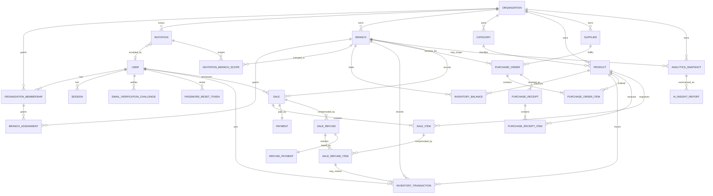

# StockWise Database Contract

| Field | Value |
| --- | --- |
| Status | Architecture Freeze v1 data contract; application persistence implemented through Phase 7; Phase 8 NOT STARTED |
| Database | PostgreSQL |
| ORM/migrations | Prisma |
| Baseline | Architecture Freeze v1 |
| Last updated | 2026-10-08 |

## 1. Scope and authority

This document is the Source of Truth for StockWise's logical entities, ownership, relationships, constraints, indexes, lifecycle rules, and transaction invariants. It does not choose physical identifier types, quantity precision, or unresolved business states.

Metric formulas belong to `docs/contracts/ANALYTICS.md`. HTTP payloads belong to `docs/contracts/API.md`. Product questions are tracked only in the master Open Questions register in `BUILD_SPEC.md`.

### Prisma foundation

`apps/api` owns Prisma configuration at `apps/api/prisma.config.ts`, the
PostgreSQL schema at `apps/api/prisma/schema.prisma`, reviewed migrations at
`apps/api/prisma/migrations/`, and the ignored generated client at
`apps/api/src/generated/prisma/`. P1-M3-T02 established the empty foundation;
P2-M1-T02 adds only the accepted identity and tenancy models, their initial
forward migration, and the later nullable-display-name correction migration.

The API validates its required server-only `DATABASE_URL` before runtime use.
Prisma CLI generation and schema validation work without a populated local URL;
commands that access PostgreSQL, including future migrations, require that URL.
Generated clients are regenerated locally and in quality commands, while
migrations remain reviewable source files. P2-M1-T02 selects UUID primary keys,
`snake_case` PostgreSQL table/column/constraint names through Prisma mappings,
and millisecond-precision `TIMESTAMPTZ` UTC instants. Later model tasks must
continue those physical conventions unless an accepted migration changes them.

P5-M1-T02 adds the reviewed
`20260905120000_add_sale_payment_schema` forward migration: bounded Organization
Sales-VAT state/rate, immutable completed-by-existence Sale/SaleItem/one-Payment
facts, exact discount/VAT/cost/idempotency constraints, and tenant-safe negative
`SALE` inventory provenance. Checkout service/API/UI behavior remains owned by P5-M2.

### Database test harness

P1-M3-T03 adds API-owned test support under `apps/api/src/test/` without adding
a Prisma model, business table, or migration. Database tests use the separate,
server-only `TEST_DATABASE_URL`, never the API runtime `DATABASE_URL`. The test
URL must be PostgreSQL, loopback-only, name a database ending in `_test`, and
differ from `DATABASE_URL`; the harness validates those rules before it creates
or resets anything. The local test role creates the disposable target database
through its local `postgres` database when necessary.

Each Vitest run provisions the target, applies committed migrations with
`prisma migrate deploy`, then clears public-schema table data with
`TRUNCATE ... RESTART IDENTITY CASCADE` while preserving Prisma migration
metadata and the initial LEGACY `native_auth_transition` singleton, and removes
only the harness-owned `stockwise_test_harness` scratch schema. When the fence table
exists, reset takes a transactional fence read and refuses a transitioned or
missing singleton before destructive statements; it cannot reconstruct Legacy
authority. Test files run
serially because they intentionally share one resettable target. The irreversible
D5-P3 suite runs last on its owned cluster, which is then destroyed, not reset.

Run `pnpm test` for the full suite or `pnpm test:db` for the focused harness.
Both require `TEST_DATABASE_URL` in the invoking process environment. Test
setup never takes that target from `.env`; it may read `.env`'s runtime
`DATABASE_URL` only to reject a collision. Use a fresh loopback database ending in
`_test`; only the optional `?schema=public` URL query is accepted so connection
overrides cannot redirect it. The known stale `stockwise_test` is refused by
default. CI explicitly opts into that name with
`STOCKWISE_ALLOW_STOCKWISE_TEST=1` for its ephemeral
PostgreSQL service. Playwright E2E setup follows the same rule. Package-scoped
web unit tests use their own Vitest config and do not invoke database setup.

### Implemented identity and tenancy schema

P2-M1-T02 creates exactly these PostgreSQL-backed Prisma models. The forward
`20260824120921_make_user_display_name_nullable` correction makes only
`User.displayName` nullable so registration can persist before profile/onboarding:

- `User`, `Organization`, `OrganizationMembership`, `Branch`, and
  `BranchAssignment`
- `Session`, `EmailVerificationToken`, and `PasswordResetToken`
- `Invitation` and `InvitationBranchScope`
- `MembershipAccessEvent` and `MembershipAccessEventBranchScope` (bounded
  P2-M3-T03 access-lifecycle provenance only)

The forward `20260824210000_membership_access_provenance` migration adds a
stable membership resource ID while retaining the existing
`(organizationId,userId)` primary identity, tenant-safe invitation
issuer/revoker and membership-source references, terminal revocation reasons,
and immutable access-event/scope-snapshot tables. It fails closed if manually
inserted pre-T03 invitations exist because a trustworthy issuer cannot be
fabricated.

Email identity is stored canonically as surrounding-whitespace-trimmed,
lowercase text. The API implementation must perform that normalization before
persistence; PostgreSQL rejects a non-canonical stored value and uniquely
indexes the canonical `User.email`. `Invitation.invitedEmail` uses the same
stored representation. Password and opaque-token columns store only hashes;
there is no plaintext session, verification, reset, or invitation-token column.

Statuses are deliberately limited to the accepted lifecycle boundary:
`ACTIVE`/`DISABLED` for users and `ACTIVE`/`INACTIVE` for organizations,
memberships, branches, and branch assignments. A matching deactivation
timestamp is required for every inactive/disabled row. The schema adds no
generic audit log, organization timezone, auth endpoint, provider, or
later-domain field; `MembershipAccessEvent` is deliberately limited to the T03
access transitions while `OQ-019` remains open.

The initial migration adds SQL checks and partial unique indexes that Prisma cannot
express. They validate nonblank normalized identity/hash/name fields, lifecycle
status/timestamp agreement, session expiry ordering, one-time-token state and
expiry ordering, one open verification token per user, and one open invitation
per organization/email. Expired open records must be marked revoked or replaced
in the same transaction that creates their replacement.

The display-name nonblank check remains in force when a value is present;
PostgreSQL permits `NULL` through that check. The forward correction drops only
the column's `NOT NULL` requirement, performs no table rewrite/backfill, and
does not alter the initial migration. Reintroducing `NOT NULL` requires a later
reviewed backfill and forward migration after all applicable accounts have a
profile.

`ADR-034` is implemented by the synchronized T02A schema/backend cutover.
Backend and frontend are ACCEPTED / COMMITTED. The T02A integration harness and 22-case local frontend/backend/PostgreSQL
verification were subsequently ACCEPTED (2026-10-10). Better Auth D4-N3
isolated real browser/Express/PostgreSQL integration was independently ACCEPTED
(2026-10-15). These are local/disposable-environment results, not Live
Better Auth activation. Real external email and production HTTPS remain
UNVERIFIED; Phase 8 is NOT STARTED.
`User.credentialVersion` is PostgreSQL BIGINT, initially 1, with a positive
check; password-replacement transactions atomically increment it with the hash
and password-change timestamp. Migration
`20261008000000_email_verification_challenge_cutover` renames/evolves the
24-hour verification table into `EmailVerificationChallenge`, terminalizes
every open legacy row, and preserves historical identity, ownership, hashes,
and terminal timestamps without inventing credential versions or OTP material.
The verification password proof itself is a stateless encrypted cookie and has no table.

### Better Auth additive D1 schema (verified in disposable PostgreSQL / no live cutover)

Under ADR-035 and the bounded D1 authorization, the forward migration
`20261012000000_better_auth_native_schema` adds native
`BetterAuthSession`, `BetterAuthAccount`, and `BetterAuthVerification`,
mapped to separate `better_auth_*` tables. All primary IDs are UUID;
session/account user FKs reference the unchanged `users.id` with RESTRICT
update/delete actions. Legacy Session and every existing business FK remain.
Native session tokens are recoverable credentials under ADR-035's future
session-only exception; the current legacy runtime still stores only hashes.
Password/OTP/link/reset/invitation protections are not superseded.

User adds `emailVerified` (`better_auth_email_verified`, false by default,
snapshotted from non-null `email_verified_at`) and optional `image`
(`better_auth_image`). Native name maps to existing nullable `displayName`;
there is no second user table. The snapshot is not maintained by legacy writers
and cannot authorize runtime access. Reconciliation and synchronization are
mandatory before cutover.

The non-null `password_hash` receives a valid Argon2id public dummy default
with a discarded cryptographically random preimage. Existing hashes are not
backfilled; legacy registration keeps explicitly supplying its own hash.
Native credential enrollment must write only `better_auth_accounts.password`,
never replace the domain dummy or run alongside legacy auth authority.
Schema/adapter metadata and legacy rejection have DB-free checks. D1's
isolated PostgreSQL proof recorded 29/29 PASS on 2026-10-12, including
forward migration application and constraint/UUID/FK preservation in owned
disposable databases. Later isolated D3/D4-N3 runs exercised the additive
migration chain. No application of this schema to the normal development or
production database is evidenced or authorized. See
[`BETTER_AUTH_MIGRATION.md`](../development/BETTER_AUTH_MIGRATION.md)
for mapping, lock/backfill risks, and forward recovery requirements.

### D5-P3 durable authentication transition schema

Owner-approved DEC-01/02/03 adds forward migration
`20261024000000_native_authentication_transition` after the unchanged 22-migration
inventory. `NativeAuthTransition` is a true-only singleton with one-way
`LEGACY -> QUIESCED -> NATIVE` state, immutable run/baseline and transition times.
`NativeAuthEnrollment` is append-only per-User provenance: run, canonical Native
account, source generation/change time, internal source digest and enrollment
time. Its User/account FKs are restrictive; no UUID/business FK is replaced.
The new `NATIVE_CUTOVER` enum reason describes verification revocation accurately.

PostgreSQL triggers coordinate authentication writes with the fence row and
refuse stale Legacy credential/session/reset/verification authority after freeze.
The unmounted disposable-only tool drains database work, invalidates old
authority and inserts account/provenance/marker atomically; Native credential
changes make Legacy replay a conflict. It never copies over an existing account.
Business-row reconciliation includes identity, organization, membership, role,
branch assignment and historical actor references.

This migration has only owned disposable execution authority. Production/
persistent development migration, backup restore, role hardening and application
Live activation remain separate gates. See the migration design for credential
eligibility, explicit frozen-source verification reconciliation, recovery limits
and the distinction between the internal run GUC and real deployment permissions.


### Isolated D3 pending registration (accepted in disposable environment / not live)

ADR-036 requires two additive persistence models, `PendingRegistration` and
`PendingRegistrationQuota`. `PendingRegistration` has one row per canonical
email and owns its UUID subject, credential version, Argon2id PHC hash, absolute
ten-minute registration expiry, and state. It has no row in `users` and no
`BetterAuthAccount` until successful mailbox-plus-password-proof completion.
Each challenge has a fresh identifier bound to the pending subject and
credential version. Resend changes only challenge material, preserving the
pending hash/version and original expiry. Bounded cleanup removes expired
pending registrations; expired quota windows can be pruned only after their
fixed window closes.

Successful completion atomically consumes the challenge, creates `User` with
the pending UUID, and inserts `BetterAuthAccount.password` with the already
computed PHC hash. It does not update or adopt an existing user, change any
existing UUID, or alter any existing business FK. The configured Better Auth
1.7.7 verifier must verify this directly promoted hash; `setPassword` is not
used because it hashes raw input. Completion creates no session.

`PendingRegistrationQuota` provides durable fixed-window budgets of five
registration attempts, three delivery requests, and five credential-proof
failures per canonical email per 15 minutes. A credential snapshot check does
not increment or reset the failure counter; a failed credential proof
increments it. The isolated D3 router remains separately exported and unmounted.
Its model/migration implementation and isolated database/security verification
were ACCEPTED on 2026-10-12; see the external D3 isolated final acceptance
record. This is uncommitted, non-live work and does not authorize migration
application to the normal development/production database or auth cutover.
Restart/outage/retry recovery and independent protected-API exclusion
evidence remain required before cutover.


## 2. Database-wide invariants

1. PostgreSQL is the only primary system of record.
2. `Organization` is the tenant boundary.
3. Every business record must carry or unambiguously derive organization ownership.
4. Branch-owned records must reference a branch and only organization-owned resources from that branch's organization.
5. Tenant and branch authorization is enforced in application policy and scoped persistence queries; foreign keys and constraints provide defense in depth.
6. Money and costs use PostgreSQL `NUMERIC`/`DECIMAL` and Prisma `Decimal`, never unconstrained binary floating point.
7. Event timestamps are stored in UTC. `ADR-029` derives analytics periods from one
   required Organization IANA reporting timezone; no Branch/server/browser timezone is
   authoritative.
8. Stock truth consists of an append-oriented ledger plus a transactionally consistent current-balance projection.
9. Checkout, receiving, adjustment, and reversal changes are atomic. Every accepted
   stock-decreasing movement rejects a resulting negative quantity inside its
   authoritative balance transaction; no override exists.
10. Historical sale and receipt line snapshots do not change when current catalog data changes.
11. Retried creates and scheduled jobs use stable idempotency keys/uniqueness constraints.
12. Application validation never substitutes for database constraints.
13. No hard deletion of completed operational history or inventory ledger entries is allowed.
14. Browser sessions and one-time identity tokens persist only cryptographic token hashes or MACs; raw session, verification, reset, and invitation tokens are never stored. Under `ADR-034` the verification challenge persists an OTP MAC (HMAC-SHA256) and a link hash (SHA-256) with no raw code or link, and the verification password proof is stateless and never persisted.
15. Every organization has at least one active `OWNER`; one organization role belongs to each user/organization membership, while branch access for branch-only roles is represented by assignments.
16. Purchase receiving uses THB only, exact Decimal values, `ROUND_HALF_UP` at an accepted persisted/display scale, and one atomic receipt/ledger/balance/cost/PO transition according to `ADR-026`.
17. Sales follow `ADR-027`: a Sale exists only after atomic checkout completion, has
    no initial lifecycle/status field, and is immutable with its one Payment, monetary
    allocations, VAT/cost snapshots, inventory provenance, and idempotency result.

## 3. Conceptual relationship model



The diagram is logical. It does not authorize optional features such as transfers or refunds.

## 4. Entity contracts

Fields are logical attributes. Exact Prisma names, mapped SQL names, ID types, enum representations, and nullability must be finalized in the schema task without changing the business meaning.

### 4.1 Identity and tenancy

#### `User`

Purpose: one platform identity that may access multiple organizations/branches.

Required logical attributes:

- Stable identifier
- Normalized email
- Argon2 password hash for MVP email/password identity
- Credential version: positive `BIGINT`, initial 1, incremented by the
  database on every password replacement (even to the same password); the
  hash, `passwordChangedAt`, and version change together
- Account status
- Display name, nullable until the later required profile/onboarding flow, and optional phone
- Created/updated timestamps
- Credential/security timestamps needed for verification, reset, session revocation, and account deauthorization

Constraints and indexes:

- Email is globally unique after documented normalization.
- A non-null display name must contain non-whitespace content; registration must
  not synthesize a placeholder from the email.
- Password hash is never selected into general user DTOs, logs, analytics, or AI data.
- The credential version is positive and never decreases; the password hash,
  `passwordChangedAt`, and version change together.
- Index account status only if a proven query requires it.

Lifecycle:

- Registration creates an email/password account with `displayName` and
  `emailVerifiedAt` set to `NULL` and `credentialVersion = 1`.
- The implemented T02A `ADR-034` cutover makes registration atomically create
  the bound verification challenge and prepare the real verification proof.
  The historical P2-M2-T01 baseline created neither.
- Every password replacement, reset, or any later accepted credential change
  increments `credentialVersion` together with the hash and
  `passwordChangedAt`.
- P2-M2-T03 originally owned verification-token creation, resend, provider delivery,
  and verification; the T02A cutover now implements the superseding `ADR-034`
  challenge/proof/delivery contract. Profile/onboarding later supplies
  the required display name.
- Deactivation must preserve historical actor references.
- Physical deletion/anonymization and retention require an accepted policy.

Product-ACCOUNT-01 self-profile maintenance reuses `displayName`/`phone` and
the existing millisecond `updatedAt`; it requires no schema migration.
The update compares the authenticated user's ID and exact prior version in
one SQL mutation, returns that mutation's safe row and advances the version
monotonically. No credential, session, membership or onboarding-provenance
field is written by this path.

#### `Organization`

Purpose: tenant and business ownership boundary.

Required logical attributes:

- Stable identifier
- Display name
- Organization status
- Sales VAT application status: `UNCONFIGURED`, `NOT_REGISTERED`, or `REGISTERED`
- Nullable sales VAT rate targeting `DECIMAL(9,6)`
- Required IANA reporting timezone accepted by `ADR-029`; P6-M1-T02 adds it through a
  forward schema migration with explicit `Asia/Bangkok` default/backfill and no Branch timezone
- Created/updated timestamps

Constraints and indexes:

- Organization names are not assumed globally unique.
- A unique human slug/code is not required unless accepted later.
- `REGISTERED` requires a non-null rate greater than zero and less than `100`;
  `UNCONFIGURED` and `NOT_REGISTERED` require a null rate. `UNCONFIGURED` is an
  application configuration state and not a legal registration classification.
- P5-M1-T02 initializes existing and newly created Organizations to `UNCONFIGURED`
  with a null rate so migration/onboarding never silently asserts legal VAT status.

ADR-037 organization name settings reuses only `name` and `updatedAt`.
The mutation locks/revalidates required actor, organization and membership
authority, compares the exact prior version in an atomic update, returns its
own written row and advances the version by at least one millisecond.
VAT status/rate, reporting timezone, memberships, branches and sessions are
unchanged. No schema change or migration is required or authorized.

Lifecycle:

- Created through the accepted onboarding flow.
- Suspension/deactivation must deny new operational writes while preserving history.
- Deletion and retention are unresolved and must not become cascade deletion of operational history.

#### `OrganizationMembership`

Purpose: links a user to an organization-wide role/scope.

Required logical attributes:

- Organization identifier
- Stable membership resource identifier
- User identifier
- Organization-scoped role
- Membership status
- One organization role: `OWNER`, `ADMIN`, `BRANCH_MANAGER`, `INVENTORY_STAFF`, or `CASHIER`
- Active/inactive lifecycle and nullable unique source-invitation provenance
- Created/updated timestamps

Constraints and indexes:

- Unique `(organization, user)` membership identity across all statuses.
- Unique `(organization, stable membership ID)` and at most one membership per
  source invitation; the source invitation must carry the same organization.
- Index by user for accessible-organization lookup.
- Index by organization for member administration.
- Exactly one organization role applies to a user within an organization. `OWNER`/`ADMIN` are organization-wide; `BRANCH_MANAGER`, `INVENTORY_STAFF`, and `CASHIER` additionally require branch assignments. The application transaction/policy layer preserves at least one active `OWNER` and prevents unauthorized role delegation.

#### `Branch`

Purpose: operational scope within an organization.

Required logical attributes:

- Organization identifier
- Stable identifier
- Branch code
- Display name
- Required display name; optional phone and address
- Branch status
- Created/updated timestamps

Constraints and indexes:

- Unique `(organization, branch code)`.
- Post-onboarding branch code and organization ownership are immutable.
- Codes are canonical uppercase ASCII, 1–16 characters, match
  `[A-Z0-9][A-Z0-9_-]*`, and are unique only within their organization. `MAIN`
  is not globally reserved.
- A branch cannot reference another organization.
- Branches use only `ACTIVE`/`INACTIVE`; deactivation sets `deactivatedAt`,
  reactivation clears it, and no branch-management delete exists.
- A lifecycle transaction locks the organization row and refuses to deactivate
  its last active branch. The lock serializes competing deactivations.
- Branch edits and lifecycle changes compare the exact prior millisecond UTC
  `updatedAt`; a mismatch is a stale-write conflict. A same-state lifecycle
  request with the matching version is idempotent and does not advance the row.
- Branch assignments are preserved when a branch becomes inactive. They confer
  no active operational authority or active navigation context while inactive,
  but an existing active, non-revoked assignment may still authorize historical
  read-only access under the endpoint's permission/scope rules (`ADR-020`).
  Removing/revoking the assignment removes that branch-scoped historical access.
  Operational authority returns on reactivation only if the assignment and
  membership remain active; no assignment permits new operations on an inactive
  branch.

`BranchStatusEvent` is the append-only authority for historical Branch activity.
An insert records the initial status at `createdAt`; a status change records its
new status at the same `updatedAt` instant used by the lifecycle transaction.
Database triggers write these events atomically with Branch changes and reject
event updates/deletes. The `(Branch, effectiveAt DESC, id DESC)` index gives a
stable latest-event lookup, and a composite Branch/Organization FK enforces
tenancy. Same-state requests and ordinary Branch edits add no event.

The forward migration records each existing Branch's *current* status only at
the migration baseline instant. Earlier deactivate/reactivate history cannot be
recovered: a due instant before the first event returns unavailable, never a
guessed status. Branch-scoped scheduled generation or replay requires an event
at or before the original due instant; an unavailable result skips that Branch
report. The Organization aggregate still includes historical facts from inactive
Branches under `ADR-029`.

#### `BranchAssignment`

Purpose: grants a user with a branch-only organization role access to one explicit branch.

Required logical attributes:

- Branch identifier
- User identifier
- Membership status
- Created/updated timestamps

Constraints and indexes:

- Unique `(branch, user)` active assignment identity.
- Index by user for branch switching.
- Index by branch for administration.
- The user's active organization membership must belong to the branch's organization and have a branch-only role. `OWNER`/`ADMIN` do not need assignments for branch access.

#### `FirstOrganizationOnboarding`

Purpose: durable one-time provenance and replay identity for the platform user's
first organization flow.

Required physical attributes and invariants:

- `userId` is the primary key, so exactly one provenance row may exist per user.
- `organizationId` is unique; `(organizationId, userId)` restrictively references
  the exact membership created by onboarding, proving that the recorded user and
  organization belong to the same membership identity.
- `(branchId, organizationId)` is unique and restrictively references the existing
  composite branch identity, proving that the recorded initial branch belongs to
  the recorded organization.
- `requestHash` is exactly one lowercase 64-hex-character SHA-256 value derived
  internally from the canonical six-field request; it is not an API credential or
  response field.
- `completedAt` is a UTC completion timestamp.
- Membership and branch update/delete actions are `RESTRICT`; their existing
  foreign keys continue to protect the user and organization. Replay
  reconstructs safe current resource data rather than storing an HTTP response blob.

The row does not replace membership authorization. The same transaction creates
the user's `OWNER` membership for its recorded organization, while organization-
wide OWNER access deliberately creates no `BranchAssignment`.

#### `Session`

Purpose: server-side browser-authentication state for one user session.

Required logical attributes:

- User identifier
- Cryptographic hash of the opaque session token, unique for lookup
- Issued, last-used, idle-expiry, and absolute-expiry timestamps
- Revoked timestamp/reason where applicable
- Created/updated timestamps

Constraints and lifecycle:

- The raw token is never persisted. A session is valid only while unrevoked, its user is enabled/authorized, and neither expiry has passed.
- Successful authentication creates a fresh session. If the incoming `stockwise_session` cookie identifies a currently valid session for the same user, revoking it as `login_rotation` and creating the fresh record is one transaction. Unknown, malformed, revoked, or expired incoming tokens are not reused.
- Initial idle expiry is issue time plus the configurable 24-hour baseline; absolute expiry is issue time plus the configurable seven-day baseline. Absolute expiry is immutable. After a valid authenticated request, activity is persisted at most once per 15 minutes: `lastUsedAt` becomes the touch time and idle expiry becomes `min(touch + idle timeout, absolute expiry)`. A required touch failure fails authentication closed, and an expired session is never revived.
- Logout conditionally revokes the current hash-identified open session as
  `logout`; authenticated all-session logout revokes every open session for the
  actor as `logout_all`. Password reset revokes every open session for the user
  as `password_reset` in the password/token transaction. Repeated current
  logout is idempotent and no user-wide mutation may affect another user.
- Index active-session lookup by token hash and user-wide revocation/query paths by user and expiry/revocation state.

#### `EmailVerificationChallenge` and `PasswordResetToken`

Purpose: persisted unified email-verification challenge (code plus link) and
single-use password-recovery proof.

The historical P2-M2-T03 link-only table has been evolved and renamed to
`email_verification_challenges`; no live legacy-link compatibility remains.
The implemented `ADR-034` model is:

Required logical attributes (`EmailVerificationChallenge`):

- Stable challenge UUID `id` and `userId`, restrictively referencing platform
  `User`; no organization/tenant ownership column or authority
- Immutable issuance `credentialVersion`, not an FK to the mutable user version
- `otpMac`: HMAC-SHA256 over purpose/encoding, user ID, challenge ID, version,
  and the six-digit code, keyed by an OTP-dedicated key of at least 32 bytes;
  the raw code is never persisted
- `linkTokenHash`: SHA-256 of the 32-random-byte base64url (43-character) link; the
  raw link is never persisted
- `otpKeyId` identifying the dedicated OTP key
- `failedOtpAttempts` constrained to integers 0 through 5
- `issuedAt`, `expiresAt`, `consumedAt`, `consumedVia` (OTP/link),
  `replacedAt`, `revokedAt`, and narrow `revocationReason`
- Created/updated timestamps

Physical cutover representation:

- `isLegacy` marks only pre-cutover rows. An INSERT/UPDATE trigger rejects
  newly forged legacy history and changes to this discriminator; every legacy
  row must remain terminal with null version, OTP MAC/key ID, and attempt count.
- Target rows require all security fields even when already terminal.
  OTP MAC and link SHA-256 are 64 lowercase hex characters (32-byte digests).
  The link column retains VARCHAR(128) to preserve arbitrary historical hashes.
- Historically consumed rows are identified as `LINK`; their existing
  `consumedAt = expiresAt` boundary remains valid. Target consumption requires
  strict `< expiresAt`, and target expiry is exactly issuance plus ten minutes.
- Narrow revocation reasons are `LEGACY_CUTOVER`, `DELIVERY_SUPPRESSED`,
  `DELIVERY_FAILED`, `RESPONSE_ABORTED`, and `PASSWORD_RESET`. Legacy open rows
  use `LEGACY_CUTOVER` with revocation no earlier than issuance, including
  baseline-valid future-issued rows. No generic persisted status is added.

Deployment is a synchronized cutover: stop legacy verification writers before
applying the transactional migration and starting the matching backend with
dedicated keys. Renames and column additions take table locks; legacy backfill
and constraint validation scan verification history. The constant user default
uses PostgreSQL's fast-default path rather than a user-table data rewrite.
A failed migration transaction rolls back its DDL/backfill. After successful
cutover, recover forward; do not restore old runtime or legacy live credentials.

Constraints and lifecycle:

- The code is 6 uniform ASCII digits with leading zeros allowed; the link is
  32 random bytes base64url-encoded to 43 characters. Both share one
  10-minute expiry from issuance.
- `OPEN` permits both methods; `LINK_ONLY` disables OTP. Expiry is an
  effective unusable state. `CONSUMED`, `REPLACED`, and `REVOKED` are terminal.
  Unique `linkTokenHash` supports lookup; partial unique `userId` where all
  terminal timestamps are null enforces one nonterminal challenge per user.
  Index `(userId, expiresAt)` supports lifecycle lookup.
- Checks enforce digest sizes for new rows, positive version, attempt bounds,
  expiry after issuance, mutually exclusive terminal timestamps, valid terminal
  time ordering, and consumption strictly before expiry.
- Five durable wrong code comparisons move the challenge to `LINK_ONLY`; the
  link survives. Either method consumes both.
- Replacement locks the user row first, terminalizes the prior non-terminal
  challenge as `REPLACED` (terminalizing expired open challenges), and
  inserts the fresh challenge bound to the current `credentialVersion` in one
  transaction.
- Completion requires the current credential proof:
  `proof.subject = challenge.userId = user.id` and
  `proof.credentialVersion = challenge.credentialVersion = user.credentialVersion`, re-checked
  under the user lock with fresh database time; the user must be `ACTIVE` and
  unverified. Wrong well-formed code on an otherwise usable, matching challenge
  increments attempts even without proof. Unknown/stale/terminal requests cannot
  affect successors. Correct OTP without usable proof adds no failure; valid OTP
  or link with unusable proof leaves the challenge unconsumed.
- The verification password proof itself is stateless: an AES-256-GCM
  encrypted cookie with a dedicated 32-byte key. No proof-specific persistence
  or revocation row; live user status/version still invalidates its authority.
- Cutover evolves existing verification persistence through a forward migration
  and initializes current user versions to 1, without inventing prior generations.
  Invalidate every legacy open link; preserve terminal history with absent
  legacy-only version/OTP fields allowed only for terminal historical rows.
  New nonterminal rows require complete version/OTP fields. No mixed old/new
  live-token runtime or compatibility shim; never edit applied migrations.

Required logical attributes (`PasswordResetToken`):

- User identifier; unique cryptographic token hash.
- Issued, expiry, consumed, replacement/revocation, and created/updated times.
- Raw token is never persisted; retain the 32-byte CSPRNG/SHA-256 boundary,
  single use, 30-minute expiry, and ACTIVE/verified-only eligibility.
- Issuance locks user before replacing open reset material. Exact-token delivery
  compensation cannot overwrite a successor.
- Completion rejects invalid token state before Argon2 outside locks, then
  locks user before token and rereads state. Atomically consume, update
  `passwordHash`/`passwordChangedAt`/`credentialVersion`, invalidate open
  verification material, and revoke all sessions. Failure rolls everything back;
  completion never creates a session.
- Isolated native D4-N2 adds `requiresNativeDeliveryConfirmation` (false for
  existing/legacy rows) and nullable `deliveryConfirmedAt`. Native issuance
  sets the flag and leaves confirmation null; validation rejects pending
  delivery. Acknowledged delivery confirms only the same non-terminal,
  unexpired token after user/token locks and native eligibility revalidation.
  Native issue/validation timestamps use PostgreSQL time; native completion
  changes Better Auth credential PHC and deletes native sessions, not legacy
  password/session state.
- `NativePasswordResetQuota` stores only a SHA-256 canonical-email key,
  database-clock fixed-window start and admitted-attempt count (1–3).
  Atomic PostgreSQL admission enforces three native requests per 15 minutes
  across instances, before eligibility lookup. Legacy quotas are unchanged.
  Migration `20261012050000_native_password_reset_delivery_quota` is additive;
  deployment is separately authorized and must precede native writer use.
  Recovery leaves additive columns/table intact and keeps the native gate off;
  no destructive down migration or legacy writer change is required.

#### `Invitation`

Purpose: email-bound, organization-scoped invitation that records the intended membership role and branch scope before acceptance.

Required logical attributes:

- Organization identifier, normalized invited email, intended organization role, and intended branch assignments
- Cryptographic invitation-token hash, unique for lookup
- Issued, expiry, consumed, revoked/replaced, and accepted-by-user timestamps
- Same-organization issuer membership; nullable same-organization revoker
  membership and explicit terminal reason
- Created/updated timestamps

Constraints and lifecycle:

- Raw tokens are never persisted. Invitations are single-use, expire after seven days, and reissue/replacement invalidates the prior active invitation.
- Acceptance requires authentication and verified ownership of the invited email. The membership and branch assignments are created atomically and idempotently.
- A changed intended role or branch scope revokes the old invitation and creates a replacement; no automatic account creation or cross-email linking occurs.
- Delivery failure conditionally records `DELIVERY_FAILED`; management revoke
  records `CANCELLED`; reissue records `REPLACED`. A concurrent pre-existing
  membership winner records the bounded `MEMBERSHIP_EXISTS` terminal reason.

#### `MembershipAccessEvent`

Purpose: immutable, task-scoped provenance for invitation acceptance and
membership effective-access transitions. It is not the generic audit mechanism
left open by `OQ-019`.

Each row stores the same-organization target membership, global actor user,
nullable same-organization actor membership, event type, before/after
role/status, and UTC occurrence time. A separate immutable scope table snapshots
the resulting configured branch IDs for branch-scoped access. Composite foreign
keys prove that target, actor membership, event, and every snapshotted branch
belong to the recorded organization. Restrictive foreign keys preserve
relationships, and table-specific triggers reject event/snapshot update or
delete operations. Test-harness `TRUNCATE` remains available only behind the
guarded disposable-database boundary.

### 4.2 Catalog

#### `Category`

Purpose: organization-level product classification.

Required logical attributes:

- Organization identifier
- Stable identifier
- Trimmed display name and internal normalized identity key
- Optional description
- Status
- Created/updated timestamps

Constraints and indexes:

- Category belongs to exactly one organization.
- Category is flat; no parent/hierarchy or merge exists in MVP.
- The NFKC/trim/collapsed-Unicode-whitespace/lowercase normalized identity key is unique per organization; the trimmed display name preserves presentation and need not be lowercase.
- Products may keep a nullable category reference; uncategorized products are accepted.
- An inactive category remains referenced but cannot receive a new product assignment. Category mutations use exact `updatedAt` optimistic concurrency.

P3-M1-T02 persists this contract in `categories` with UUID `id` and
`organization_id`, `TEXT` display/normalized names and optional description,
the shared `catalog_status` enum, and millisecond UTC `created_at`/`updated_at`.
The database rejects blank or non-trimmed display names using the explicit
Unicode whitespace set used by the application boundary. The application-owned
catalog value helper computes `normalized_name`; a unique
`(organization_id, normalized_name)` index is the final concurrent-write
boundary, with bytewise `C` collation making equality independent of the
database's default locale. Unique `(id, organization_id)` supports same-tenant composite
references. Organization deletion/update and referenced Category
deletion/update are restrictive.

#### `Product`

Purpose: organization-level catalog item referenced by all branch operations.

Required logical attributes:

- Organization identifier
- Stable identifier
- Optional category identifier from the same organization
- SKU
- Optional barcode
- Name
- Optional description/brand
- One immutable MVP base unit
- Required current organization base price
- Optional low-stock/reorder configuration after analytics definitions are accepted
- Status
- Created/updated timestamps

Constraints and indexes:

- SKU is persisted in its trim/NFKC/uppercase canonical form and is unique as `(organization, sku)`.
- Barcode is a trimmed, control-character-free value of at most 128 characters; it is unique as `(organization, barcode)` when non-null, with exact stored-value equality.
- Category, if present, must belong to the same organization.
- Base price targets `DECIMAL(19,4)`, is non-negative, and must not be silently rounded at the API boundary.
- Unit is one of `EA`, `PACK`, `BOX`, `KG`, `G`, `L`, `ML`, `M`, or `CM`. Quantity values target `DECIMAL(18,4)`; `EA`, `PACK`, and `BOX` are integer-only.
- Index `(organization, status, name)` or a more suitable search index based on measured search behavior.
- Product status changes must not rewrite historical sale, purchase, receipt, or ledger records.

P3-M1-T02 persists this contract in `products` with UUID `id`, required
`organization_id`, nullable `category_id`, trimmed `TEXT` name, optional `TEXT`
description, canonical `VARCHAR(64)` SKU, nullable exact `VARCHAR(128)` barcode,
`DECIMAL(19,4)` `base_price`, `product_unit`, shared `catalog_status`, and
millisecond UTC timestamps. It implements:

- unique `(organization_id, sku)` and `(organization_id, barcode)` indexes;
  PostgreSQL unique-null semantics permit multiple uncoded Products while
  serializing every non-null barcode conflict, and bytewise `C` collation
  preserves exact canonical SKU/barcode equality across database locales;
- a composite `(category_id, organization_id)` foreign key to Category's
  `(id, organization_id)` key, plus direct restrictive organization ownership;
- database checks for a trimmed/nonblank Product name, canonical SKU grammar,
  trimmed/nonblank/control-character-free barcode, and non-negative base price;
- organization/status/name and category/organization indexes for the accepted
  catalog access paths.

`parseCatalogBasePrice` rejects negative, excess-scale, non-decimal, and
out-of-range catalog strings before Prisma creates a `Decimal`; PostgreSQL then
stores the accepted value at exact scale four. This application check is
mandatory because PostgreSQL coerces input to a declared `DECIMAL(19,4)` before
a row check can observe excess source precision. Product contains no branch,
stock/quantity, unit-conversion, supplier, cost/valuation/COGS, or branch-price
column.

Lifecycle:

- Prefer deactivation over deletion once referenced.
- Product and Category use `ACTIVE`/`INACTIVE`; reactivation is allowed and neither has a hard-delete endpoint in MVP.
- Product deactivation preserves historical references. Category deactivation neither deletes nor deactivates products and never silently reassigns them.
- Base-price changes affect future operations only. Branch price overrides are out of MVP scope.
- Product and Category mutations use their exact prior millisecond UTC `updatedAt`; stale writes map to `PRODUCT_STALE` and `CATEGORY_STALE`.
- Product has no organization-wide cost, average-cost, COGS, or inventory-valuation attribute. `ADR-026` assigns cost state to the separate Branch/Product projection implemented by P4-M3-T01.

P3-M1-T03 implements these as service/database boundaries without a schema
change. Mutations condition on `(id, organization_id, updated_at)` and assign a
strictly later millisecond timestamp. Product creation/reassignment holds a
same-tenant Category row lock while verifying active status, preventing a
concurrent deactivation from bypassing the active-assignment rule. The existing
unique indexes remain the final concurrent category-name, SKU, and non-null
barcode conflict boundary; adapter errors are translated to catalog domain
codes without exposing database metadata. Lists use `(created_at, id)` keyset
continuation within the trusted organization scope.

#### `Supplier`

Purpose: organization-level purchasing counterparty.

Required logical attributes:

- Organization identifier
- Stable identifier
- Name
- Contact details appropriate to the accepted product scope
- No persisted lead time; `ADR-032` uses an explicit non-persisted caller
  planning input for Reorder V1
- Status
- Created/updated timestamps

Constraints and indexes:

- Supplier belongs to one organization.
- Supplier business fields are not unique; duplicate names, emails, and phone numbers are allowed. Lifecycle is `ACTIVE`/`INACTIVE`, with no hard-delete endpoint; inactive Suppliers remain historically readable.

P4-M1-T02 records the bounded Supplier contract: `name` (trimmed, 1–160), optional trimmed `contactName` (120), lowercase valid `email` (254), trimmed `phone` (40), and trimmed `address` (500), with blanks stored as `NULL`. No optimistic version applies. The indexed list is organization/status/newest-first.

### 4.3 Inventory

#### `InventoryBalance`

Purpose: query-efficient current quantity for one product at one branch.

Required logical attributes:

- Organization identifier
- Stable identifier
- Branch identifier
- Product identifier
- Current quantity as `DECIMAL(18,4)` using the Product's accepted immutable base unit
- Created/updated timestamps

Constraints and indexes:

- Unique `(branch, product)`.
- Inventory records carry `organizationId` and use composite foreign keys to
  `Branch(id, organizationId)` and `Product(id, organizationId)`; the Product
  composite relational key is implemented by P3-M2-T02.
- A database constraint enforces non-negative quantity. A missing balance row
  represents zero and balance rows are created lazily only by a successful first
  movement.
- Read/update access is normally keyed by `(branch, product)`.

Invariant:

`InventoryBalance.quantity` must equal the accepted ledger projection for the same branch/product, accounting for any explicitly documented opening/import checkpoint. Reconciliation must detect divergence.

P3-M2-T02 persists this contract in `inventory_balances` with UUID `id`, required
`organization_id`, `branch_id`, and `product_id`, exact `DECIMAL(18,4)`
`quantity`, and millisecond UTC timestamps. Unique `(branch_id, product_id)`
enforces one lazy projection row per Branch/Product. A quantity check rejects
negative stored balances. Composite restrictive foreign keys bind Branch and
Product to the row's organization; the Product `(id, organization_id)` key is
added by the same migration. There is no optimistic version column because the
accepted mutation design serializes authoritative balance state pessimistically.

`ADR-026` does not put cost in this quantity projection. P4-M3-T01 adds a separate,
tenant-safe Branch/Product `inventory_cost_states` projection that distinguishes
`UNKNOWN` from `KNOWN`, records inventory value and moving-average unit cost, and
participates in the same receipt and manual-adjustment transaction. `UNKNOWN` is not
zero cost: it means authoritative valuation, COGS, and gross margin are unavailable
for cost-dependent operations involving that stock.

#### `InventoryTransaction`

Purpose: append-oriented explanation of every stock change.

Required logical attributes:

- Stable identifier
- Branch identifier
- Product identifier
- Movement type
- Signed, non-zero quantity delta as `DECIMAL(18,4)` using the Product's accepted
  immutable base unit. Positive increases and negative decreases stock. API output
  removes meaningless trailing fractional zeros.
- Bounded source: signed `MANUAL_ADJUSTMENT`, positive `PURCHASE_RECEIVE`, negative
  `SALE`, or positive `SALE_REFUND_RETURN`
- Acting human user plus membership/context sufficient for durable attribution, or
  an explicit trusted system/source identity for future system-created movements
- Adjustment reason/note where applicable
- Occurred/created timestamp
- Idempotency/source uniqueness metadata: deterministic opaque-key hash and canonical
  request hash scoped to organization and operation, plus direct source-line linkage where one operation creates multiple movements

Accepted movement concepts:

- Purchase receipt: positive `PURCHASE_RECEIVE`, linked uniquely to one immutable receipt item
- Sale: negative `SALE`, linked uniquely to one immutable SaleItem
- Manual adjustment: signed; reason is `STOCK_COUNT`, `DAMAGE`, `LOSS`, `FOUND`,
  `CORRECTION`, or `OTHER`
- Refund return: positive `SALE_REFUND_RETURN`, linked uniquely to one immutable
  SaleRefundItem with positive restock quantity; financial-only refund items create no
  inventory movement
- Transfer out/in: deferred from MVP by `ADR-025`; no transfer ledger source exists

Constraints and indexes:

- Quantity delta cannot be zero.
- Inventory records carry `organizationId` and use the same composite Branch/Product
  foreign-key strategy as InventoryBalance, so branch and product cannot cross tenants.
- One source line cannot produce the same movement twice.
- Index `(branch, product, occurredAt, id)` for history and reconciliation.
- Index source reference for traceability/idempotency.
- Ledger rows are not edited or deleted to correct mistakes; create an authorized compensating transaction.
- `OTHER` requires a nonblank trimmed note. Other adjustment notes are optional;
  a blank optional note becomes null. Supplied notes trim only surrounding
  whitespace, preserve internal Unicode and whitespace, and must not contain
  credentials, tokens, or secrets.

P3-M2-T02 initially persists this contract in `inventory_transactions`; P4-M3-T01
extends it with nullable `purchase_receipt_item_id` and makes adjustment-only
reason/note/idempotency fields conditional on source. Manual adjustments retain the
organization-scoped SHA-256 idempotency identity. Purchase receipt movements instead
carry one direct tenant/branch/product-safe receipt-item link, with a unique mapping
from each receipt item to exactly one movement; they do not copy the receipt-level
idempotency hash onto every line.

Database checks reject zero delta, unsupported sources, invalid manual-adjustment
reason/note/hash shapes, or a `PURCHASE_RECEIVE` row that is non-positive, lacks its
receipt-item link, or carries adjustment-only fields. History uses
`(branch_id, product_id, occurred_at, id)`.

### 4.4 Purchasing and receiving

#### `PurchaseOrder`

Purpose: records an order from an organization supplier for delivery to one branch.

Implemented by P4-M2-T01 as `purchase_orders`: organization/branch/supplier and
creator-membership provenance, organization-unique `reference`, accepted
status enum, order/expected dates, THB-only currency, expected total, and lifecycle
timestamps. It has composite tenant-safe Branch/Supplier/creator foreign keys and the
required `(organization, branch, status, orderDate)` index. P4-M2-T02 implements
the API lifecycle: DRAFT-only edits with exact `updatedAt` optimistic concurrency,
`DRAFT -> ORDERED`, `DRAFT -> CANCELLED`, and `ORDERED -> CANCELLED`; ORDERED
snapshots are frozen and RECEIVED/CANCELLED are terminal. P4-M3 implements atomic
receiving, receipt Input VAT snapshots, stock balance/ledger writes, and
Branch/Product cost-state updates.

Required logical attributes:

- Organization and target branch identifiers
- Supplier identifier
- Stable identifier and immutable human-readable server-generated reference, unique within Organization in the PO namespace
- Lifecycle status: `DRAFT`, `ORDERED`, `RECEIVED`, or `CANCELLED`
- Order date and optional expected date
- THB-only currency context; no multi-currency model
- Aggregate amounts stored/recomputed using accepted Decimal and `ROUND_HALF_UP` rules where a persisted/document scale requires rounding
- Creator and relevant actor timestamps
- Created/updated timestamps

Constraints and indexes:

- Branch and supplier must belong to the order's organization.
- Human number, if used, is unique within its accepted scope.
- Index `(organization, branch, status, orderDate)`.
- `DRAFT` is editable. `ORDERED` freezes Supplier, Branch, Product lines, quantities, expected unit costs, and accepted commercial snapshots. `RECEIVED` and `CANCELLED` are terminal.
- One ordered PO produces at most one completed receipt. PO and Receipt references are separate Organization-unique namespaces; no generic numbering engine is implied.

#### `PurchaseOrderItem`

Purpose: requested product and commercial snapshot within a purchase order.

Implemented by P4-M2-T01 as `purchase_order_items`: same-organization PO/Product
composite foreign keys, non-null SKU/name snapshots, `DECIMAL(18,4)` quantity,
`DECIMAL(19,4)` expected unit cost, and one Product per PO. Quantity and monetary
checks are database-enforced; P4-M2-T02 implements API decimal-string scale
validation because PostgreSQL coerces excess scale before a row check can observe it.

Required logical attributes:

- Purchase order identifier
- Product identifier from the same organization
- Product/SKU/name snapshots needed for historical readability
- Ordered quantity
- Expected unit cost as `DECIMAL(19,4)` Decimal planning/history data
- Only accepted commercial snapshots; no line-level VAT allocation engine
- Created/updated timestamps

Constraints:

- Positive quantity.
- Product organization equals purchase-order organization.
- Unique `(purchase_order_id, product_id)` is required: one Product equals one PO line.

#### `PurchaseReceipt`

Purpose: immutable record of a receiving event against one purchase order and branch.

Required logical attributes:

- Purchase order and branch identifiers
- Stable immutable human-readable server-generated reference, unique within Organization in the Receipt namespace
- Completed receipt state only in MVP; no correction/reversal lifecycle
- Received-at time and receiving actor
- Idempotency key/source metadata
- Created/updated timestamps

Constraints and indexes:

- Receipt branch equals purchase-order branch.
- Receipt-level operation idempotency is unique within the accepted Organization/operation scope; its canonical request represents actual costs and accepted document-level VAT snapshots, never client-supplied quantities.
- A completed receipt is immutable. Supplier returns, receipt correction, and receipt reversal are future scope.
- Its PO must be `ORDERED`, receipt branch equals PO branch, and no other completed receipt may exist for that PO. Receipt item quantities are server-derived exactly from frozen PO quantities; partial/over/short/multiple receipt and receiving without a PO are excluded.
- Preserve only the accepted document-level Input VAT snapshots where applicable: the authorized receiving command's explicit receipt-time organization VAT-registration assertion, rate, amount, supplier tax-document number, and supplier tax-document date. Organization has no authoritative VAT-registration master field in MVP, so the snapshot is not server-derived from Organization. These fields do not create a generic Tax or VAT-allocation engine and do not derive/rewrite `actualUnitCost`.

P4-M3-T01 persists this aggregate in `purchase_receipts` and
`purchase_receipt_items`. Receipt idempotency/canonical hashes are lowercase SHA-256;
references and idempotency are Organization-unique; composite restrictive foreign
keys bind the Receipt to the exact PO Organization/Branch/Supplier and bind each item
to its frozen PO item/Product. Input VAT uses nullable `DECIMAL(9,6)` rate and
`DECIMAL(19,4)` amount as an optional pair, plus the bounded document snapshots.

#### `PurchaseReceiptItem`

Purpose: received quantity and actual-cost snapshot for one product in a receipt.

Required logical attributes:

- Receipt and purchase-order-item identifiers
- Product identifier
- Product/SKU/name snapshots
- Received quantity
- Actual unit cost as authoritative `DECIMAL(19,4)` inventory cost-basis input
- Created timestamp

Constraints:

- Positive quantity.
- Product/order/receipt organizations and branches agree.
- Received quantity equals the frozen PO-line quantity and is positive.
- A completed receipt item maps uniquely to exactly one positive `PURCHASE_RECEIVE` movement.

#### `InventoryCostState`

Purpose: transactionally maintained Branch/Product moving weighted-average valuation
projection implemented by P4-M3-T01 in `inventory_cost_states`.

- Scope: Organization, Branch, and Product with the same tenant-safe relationship
  strategy as inventory balances.
- Basis state: `UNKNOWN` or `KNOWN`. `UNKNOWN` never means zero acquisition cost.
- Known state: inventory value and current/last-known moving-average unit cost,
  targeting `DECIMAL(19,6)` for the latter.
- Receipt authority: `actualUnitCost`; `expectedUnitCost` affects planning/variance
  reporting only, never received quantity.
- Moving weighted average uses exact Decimal arithmetic:

  ```text
  oldInventoryValue = oldQuantity * oldAverageCost
  receivedValue = receivedQuantity * actualUnitCost
  newInventoryValue = oldInventoryValue + receivedValue
  newAverageCost = newInventoryValue / newQuantity
  ```

- If a Branch/Product has positive on-hand quantity but no known basis, its first
  authoritative receipt initializes the basis for all resulting on-hand quantity at
  that receipt's `actualUnitCost`. This is prospective valuation initialization; it
  neither backfills nor fabricates historical acquisition cost/COGS.
- Once known, manual positive/negative adjustments use current/last-known average
  cost. Before known, they change quantity only and cost-dependent reporting remains
  unavailable. When quantity reaches zero, value is exactly zero and the last-known
  average cost remains. A later receipt from zero uses its actual unit cost as the
  new current average.
- Under `ADR-027`, an UNKNOWN-basis Sale decrements quantity but never initializes or
  fabricates cost. Whether resulting quantity remains positive or reaches zero, basis
  remains `UNKNOWN` and both `averageUnitCost` and `inventoryValue` remain null; the
  SaleItem snapshots UNKNOWN with null unit cost/COGS. A later authoritative receipt
  from zero may initialize current stock prospectively and never backfills that Sale.
- Under `ADR-028`, a KNOWN-cost refund return enters at the immutable original
  SaleItem unit cost. KNOWN current stock recalculates its six-place moving average
  from current quantity/current average plus returned quantity/original unit cost,
  and persists that exact weighted value sum at ten places, matching receiving. A
  KNOWN return into zero UNKNOWN quantity may initialize KNOWN. Subsequent operations
  continue to derive old basis from quantity times the retained average under
  `ADR-026` rather than treating stored value as an independently accumulated authority.
- An UNKNOWN-cost return never receives a fabricated value. It keeps UNKNOWN current
  stock UNKNOWN and conservatively changes KNOWN current stock to UNKNOWN with null
  average/value because the resulting aggregate contains unvalued units. A KNOWN-cost
  return into positive UNKNOWN stock also remains UNKNOWN. No restock changes no cost
  state.
- For `KNOWN` basis, `averageUnitCost` is authoritative. Manual adjustments retain it
  and materialize inventory value as resulting quantity times that average, rounded
  `ROUND_HALF_UP` only at the `DECIMAL(38,10)` storage boundary. Subsequent receipts
  derive old inventory value from old quantity times that retained average rather
  than accumulating an independently rounded stored value.
- Persistence uses unique `(branch_id, product_id)`, `DECIMAL(38,10)` inventory
  value, and nullable `DECIMAL(19,6)` average unit cost. A database state-shape check
  requires both numeric values for `KNOWN` and neither for `UNKNOWN`; composite
  restrictive foreign keys enforce Organization/Branch/Product agreement.

### 4.5 Sales and payment

#### `Sale`

Purpose: immutable branch-scoped checkout fact and customer-receipt root accepted by
`ADR-027`.

Required logical attributes:

- Organization and branch identifiers
- Stable identifier and immutable `SALE-<UUID>` reference
- Acting user and membership/context provenance
- Immutable Organization name, Branch name/code, and acting-user display snapshots
  needed to reproduce the receipt
- Currency constrained to `THB`
- `subtotalAmount`, `discountAmount`, nullable `taxableAmount`,
  `outputVatAmount`, and `totalAmount`, each `DECIMAL(38,2)`
- Optional whole-Sale discount type (`AMOUNT` or `PERCENT`), exactly one corresponding
  entered fixed amount `DECIMAL(38,2)` or percentage rate `DECIMAL(7,4)`, calculated
  discount amount, and required reason
- Sales VAT status/rate snapshots used at checkout; rate targets nullable
  `DECIMAL(9,6)`
- Business occurred-at/created timestamp
- Checkout idempotency key hash and canonical-request hash

Constraints and indexes:

- Branch, actor membership/context, and Organization agree through tenant-safe keys.
- Reference is unique by `(organization_id, reference)`.
- Idempotency key hash is unique by
  `(organization_id, operation_type, idempotency_key_hash)`, with operation type
  `SALE_CHECKOUT`; Branch and actor are canonical request content rather than a
  weaker namespace.
- Currency is exactly `THB`; monetary components are non-negative and total is
  positive; `subtotal_amount - discount_amount = total_amount`.
- No-discount state has null type/input/reason and zero calculated amount. AMOUNT uses
  a positive scale-at-most-two input less than subtotal. PERCENT uses a positive
  scale-at-most-four input less than `100`. A discounted Sale has a trimmed nonblank
  reason of at most 200 characters.
- REGISTERED snapshots require a non-null rate/taxable amount, zero-or-positive Output
  VAT, and `taxable_amount + output_vat_amount = total_amount`. NOT_REGISTERED
  snapshots require null rate/taxable amount and `output_vat_amount = 0.00`.
- Index `(organization_id, branch_id, occurred_at, id)` for history and analytics and
  actor only for a proven access pattern. Do not add a status index.

Lifecycle:

- No persisted Draft Sale or Cart exists. Existence of a Sale row means its checkout
  completed atomically.
- Sale has no mutable `SaleStatus` enum or status field. `ADR-028` permits only derived
  `NONE`, `PARTIALLY_REFUNDED`, or `FULLY_REFUNDED` read projection from linked refunds.
- Sale monetary, VAT, payment, item, cost, actor, reference, idempotency, and inventory
  facts are not hard-deleted or rewritten; `ADR-028` correction uses linked immutable
  SaleRefund compensation.

#### `SaleItem`

Purpose: immutable line-level sale facts independent of future catalog changes.

Required logical attributes:

- Sale identifier
- Product identifier
- Product name, SKU, and immutable base-unit snapshots; barcode snapshot is not
  required for receipt correctness
- Quantity as `DECIMAL(18,4)` using the accepted unit contract
- `unitPrice DECIMAL(19,4)` from server-authoritative `Product.basePrice`
- `lineGross`, `lineDiscount`, nullable `lineTaxable`, `lineOutputVat`, and `lineNet`
  as `DECIMAL(38,2)` deterministic document allocations
- Cost-basis snapshot (`UNKNOWN` or `KNOWN`), nullable `unitCost DECIMAL(19,6)`, and
  nullable `cogsAmount DECIMAL(38,10)`
- Unique linkage to the line's negative `SALE` InventoryTransaction
- Created timestamp

Constraints:

- Positive quantity for a normal sale line.
- One Product per Sale; duplicate Product lines are invalid.
- Product belongs to sale organization.
- Allocations are non-negative and enforce `lineDiscount <= lineGross`, `lineNet >=
  0`, `lineOutputVat <= lineNet`, and non-negative line taxable amount when present.
- Line sums equal their Sale subtotal, discount, total, Output VAT, and—when
  REGISTERED—taxable amount. NOT_REGISTERED line taxable amounts are null and line
  Output VAT amounts are `0.00`.
- KNOWN requires unit cost/COGS; UNKNOWN requires both null. Historical UNKNOWN is
  never backfilled.
- Completed line snapshots are immutable; reversal uses linked compensating records.

#### `Payment`

Purpose: records payment information associated with a sale.

Required logical attributes:

- Sale identifier
- Method: `CASH` or manually confirmed `TRANSFER`
- `amount DECIMAL(38,2)` exactly equal to Sale total
- CASH-only nullable `amountTendered` and `changeAmount`, each `DECIMAL(38,2)`
- TRANSFER-only trimmed optional reference of at most 100 characters
- Created/confirmed timestamp

Constraints:

- Exactly one Payment belongs to each Sale; its atomic existence means confirmed
  payment and no independent mutable Payment status is stored.
- CASH requires tender/change, null transfer reference, tender at least amount, and
  `amount_tendered - change_amount = amount`.
- TRANSFER requires null tender/change and may have a bounded reference.
- Sensitive payment credentials/card data are never stored directly.
- CARD, split/multiple, gateway/provider, pending, and offline payment are not modeled.

#### `SaleRefund`

Purpose: immutable branch-scoped financial compensation linked to one original Sale,
accepted by `ADR-028`. It is the only V1 reversal concept; no VOID model exists.

Required logical attributes:

- Organization, original Branch, and original Sale identifiers
- Stable ID and Organization-unique immutable `REFUND-<UUID>` reference targeting
  `VARCHAR(43)`
- Actor user/membership provenance and immutable actor display-name snapshot
- Currency `THB`; `grossAmount`, `discountAmount`, `outputVatAmount`, and
  `totalAmount DECIMAL(38,2)` plus nullable `taxableAmount DECIMAL(38,2)`
- Original sales-VAT status/rate snapshots used only to describe the historical
  allocation authority
- Required trimmed nonblank reason of 1–200 characters
- `SALE_REFUND` idempotency key hash and canonical-request hash
- Immutable `completedAt` and `createdAt` UTC timestamps

Constraints and indexes:

- Refund Organization/Branch must equal the original Sale scope through restrictive
  composite keys. Cross-branch and cross-Organization refunds are impossible.
- Reference is unique by `(organization_id, reference)`. Idempotency hash is unique by
  `(organization_id, operation_type, idempotency_key_hash)` for `SALE_REFUND`.
- Currency is `THB`; total is positive; `gross_amount - discount_amount =
  total_amount`; REGISTERED requires `taxable_amount + output_vat_amount =
  total_amount`; NOT_REGISTERED requires null taxable and zero Output VAT.
- Index original Sale plus chronological `(completed_at,id)` traversal. Do not add or
  mutate a status column on Sale.

#### `SaleRefundItem`

Purpose: immutable item-level monetary compensation and optional sellable-stock return
linked to one original SaleItem.

Required logical attributes:

- SaleRefund and original SaleItem identifiers with Organization/Branch/Product scope
- Positive `refundQuantity DECIMAL(18,4)` and non-negative
  `restockQuantity DECIMAL(18,4)` in the original immutable Product unit
- `reversedLineGross`, `reversedLineDiscount`, `reversedLineNet`, nullable
  `reversedLineTaxable`, and `reversedLineOutputVat`, each `DECIMAL(38,2)`
- Original cost-basis state and nullable original `unitCost DECIMAL(19,6)` snapshot
- Nullable `cogsReversalAmount DECIMAL(38,10)` based only on cumulative restocked
  quantity
- Optional unique positive `SALE_REFUND_RETURN` InventoryTransaction linkage

Constraints:

- One original SaleItem occurs at most once per SaleRefund. Refund item, original item,
  original Sale, Product, Branch, and Organization must agree through restrictive keys.
- `0 < refund_quantity`, `0 <= restock_quantity <= refund_quantity`, and quantity
  integrality follows the original Product unit.
- Line money is non-negative and preserves gross minus discount equals net plus the
  historical VAT/nullability shape. Header sums equal refund-item sums.
- Under the original Sale row lock, cumulative refund quantity and cumulative restock
  quantity for each original SaleItem never exceed original sold quantity.
- KNOWN original cost requires the original unit-cost snapshot and a non-null COGS
  reversal (zero when no stock is returned). UNKNOWN requires both null.
- Positive restock requires exactly one linked movement whose delta equals restock
  quantity; zero restock requires no movement.

#### `RefundPayment`

Purpose: one confirmed manual repayment for one SaleRefund.

Required logical attributes and constraints:

- Exactly one SaleRefund link; Organization/Branch and amount agree through restrictive
  keys; `amount DECIMAL(38,2)` equals SaleRefund total.
- Method equals the original Payment method. CASH has no tender/change/reference.
  TRANSFER requires one trimmed nonblank reference of 1–100 characters.
- Confirmed/created UTC timestamps. Existence means manually confirmed; no mutable
  status, split, CARD, gateway, pending, slip, or OCR state exists.

SaleRefund, SaleRefundItem, and RefundPayment are immutable and cannot be hard-deleted,
edited, refunded, or voided. They provide bounded operational attribution without a
generic audit-log subsystem.

No separate Sales Receipt table exists. Customer receipt data is a projection of the
immutable Sale, SaleItems, and Payment. No Customer/CRM relation or checkout customer
metadata is modeled in MVP.

### 4.6 Analytics and AI

#### `AnalyticsSnapshot`

Purpose: versioned, reproducible aggregate facts for a report scope and period.

P7-M1-T02 persists this as `analytics_snapshots`. One row has a UUID ID, tenant
FK, nullable composite tenant/Branch FK, `ORGANIZATION`/`BRANCH` scope, and a
non-null `scope_key` (`organization` or the Branch UUID). The database checks
that the key, kind, and nullable Branch agree. `DAILY`/`WEEKLY`/`MONTHLY`/`YEARLY`,
the Organization IANA timezone, local date bounds, exact UTC half-open bounds,
`analytics-snapshot-v1`, `analytics-v1`, source cutoff, complete-period status, and a
strictly validated JSONB aggregate payload are retained. A unique index covers
tenant, scope key, cadence, timezone, UTC bounds, schema version, and metric
version. A database trigger rejects UPDATE; deletion is reserved for later
retention work after 36 months from period end and only when no retained insight
references the snapshot.

The V1 payload contains only the existing deterministic Sales aggregate's net
sales, sale/refund counts, refund amount, average order value, growth, gross
profit/margin, and cost coverage/null reasons for one completed period. The
store reuses exact matching content and fails on changed content at the same
identity. Provider serialization is a later, separate allow-list and must omit
internal tenant/Branch IDs. No provider, prompt, or model field is stored here.
The internal builder accepts an existing tenant-owned Branch even after
deactivation so catch-up can use a scope that was active when due; the later
scheduled job must use the historical Branch status lookup at the original due
instant and skip unavailable history.

Required logical attributes:

- Organization identifier
- Optional branch identifier; null indicates an authorized organization aggregate by explicit convention
- Period type: daily, weekly, monthly, or yearly
- Canonical period start/end in UTC plus reporting timezone identifier
- Metric-definition version
- Snapshot schema version
- Structured aggregate values
- Data completeness/status
- Source cutoff/watermark
- Created timestamp

Constraints and indexes:

- Branch, if present, belongs to organization.
- Unique `(organization, branch scope, period type, period start, metric version)` or an equivalent normalized scope key.
- Snapshot payload must validate against the versioned schema in `docs/contracts/ANALYTICS.md`.
- Snapshot contains aggregates only; no individual customer/employee personal data or raw transaction lines.

Lifecycle:

- A snapshot may be recomputed only under a documented version/revision policy.
- Historical snapshots retain the definition/schema version used.

#### `AIInsightReport`

Purpose: persisted OpenRouter summary derived from one analytics snapshot.

P7-M2-T03 persists this as `ai_insight_reports` with a non-null normalized
`scope_key` (`organization` or Branch UUID), so the ordinary identity unique
index also covers Organization scope despite nullable `branch_id`. Composite
Branch/Organization and snapshot/Organization foreign keys enforce tenancy.
Each row pins snapshot ID, schema/metric versions, source cutoff, and prompt
version at creation; a trigger rejects changes to that authority and all
updates after a terminal result. States are `IN_PROGRESS`, `SUCCEEDED`, `FAILED`, and
`INSUFFICIENT`. The current Sales snapshot always has valid facts, including
zero, so T03 creates no artificial insufficient result.

`ai_insight_attempts` reserves an ordinal 1–3 before each external call and
records safe requested/actual model, start/finish times, category, and validated
usage/cost when available. A pending reservation makes the report's
`attempt_count` null to represent an unknown external outcome; completed calls
restore the known count. An expired claim with no reservation can be reclaimed;
an expired claim after provider activity becomes `FAILED/INTERRUPTED` without
another call. This bounds ordinary execution even after a crash, while
acknowledging that PostgreSQL cannot prove exactly-once external delivery.
Detailed HTTP telemetry and raw prompts, responses, errors, and credentials are
not stored. Later retention work must preserve report/snapshot references for
36 months after period end; there is no cleanup worker in T03.

Required logical attributes:

- Analytics snapshot identifier
- Organization/branch scope duplicated or derived safely for access control
- Cadence and period
- Prompt/template version
- Provider and actual model identifier when a call was attempted; absent for a
  local insufficient or pre-call failure
- Status
- Generated natural-language content on success
- Failure category and safe retry metadata on failure
- Input/output usage and cost metadata when safely available
- Attempted/generated/created timestamps

Constraints and indexes:

- One ordinary scheduled report per Organization/scope, cadence, timezone, and
  exact UTC period bounds; a controlled replay may create an explicit revision
  without replacing historical reports (`ADR-033`).
- Provider request identity supports idempotency/retry control.
- Content cannot become a source of numerical truth; the linked snapshot remains authoritative.
- No raw prompt containing secrets or prohibited data is stored.

### 4.7 Operational support records

The implementation may require records such as idempotency claims, job leases, or audit events. They are permitted implementation details only when they preserve these rules:

- Idempotency records are scoped so one tenant cannot collide with or discover another tenant's key.
- Job claims prevent duplicate report generation and expire/recover safely.
- `InventoryTransaction` is the bounded immutable domain provenance record for stock
  movements, not a replacement for the generic cross-domain audit system governed
  by `OQ-019`.
- Support records never replace domain constraints or transactional uniqueness.

## 5. Cross-tenant constraint strategy

Simple foreign keys alone may allow mismatched organization references when a branch-owned table points to both a branch and an organization-owned entity. Each schema design must demonstrate how it prevents or detects this.

Acceptable techniques include:

- Composite keys/foreign keys including `organizationId`
- Database constraints/triggers where Prisma cannot express the invariant safely
- Transactional ownership validation plus scoped unique references, backed by tests

The chosen physical approach is an implementation detail, but the invariant is mandatory. Every read and write query must still include trusted organization/branch scope.

P2-M1-T02 implements the identity/tenancy cases with composite foreign keys:

- `BranchAssignment(organizationId, userId)` references the exact
  `OrganizationMembership(organizationId, userId)`.
- `BranchAssignment(branchId, organizationId)` references the exact
  `Branch(id, organizationId)`.
- `InvitationBranchScope(invitationId, organizationId)` and
  `InvitationBranchScope(branchId, organizationId)` reference an invitation and
  branch carrying the same organization.
- Accepted invitations reference `User(id, email)` through
  `(acceptedByUserId, invitedEmail)`, preventing cross-email account linking at
  the relational boundary.
- Invitation issuer/revoker membership, membership source invitation,
  access-event target/actor membership, and access-event branch snapshots use
  composite organization keys and reject cross-tenant provenance.
- InventoryBalance and InventoryTransaction use composite Branch/Product tenant
  keys. InventoryTransaction additionally references
  `OrganizationMembership(organization_id, id, user_id)` with its organization,
  actor membership, and actor user values, so actor identity cannot disagree
  with membership or tenant provenance.

The repeated `organizationId` values in the two scope tables are deliberate
referential-integrity keys, not independently trusted tenant state. Application
queries must still begin from authenticated organization membership.

PostgreSQL directly enforces identity uniqueness, one membership per
organization/user, one assignment per branch/user, branch-code uniqueness per
organization, token-hash uniqueness, one open verification challenge per user
(partial unique), normalized email storage, the composite same-tenant
relationships above, lifecycle/temporal checks, and restrictive foreign-key
deletion.

The application transaction/policy layer enforces invariants that
cannot be represented safely by ordinary row constraints without duplicating
role state or adding fragile cross-row triggers: every organization retains at
least one active `OWNER`; branch-only active memberships have at least one
active assignment; organization-wide roles do not derive access from assignment
rows; membership deactivation/role changes update affected access atomically;
organization onboarding creates its first branch and OWNER atomically; verification
challenges expire in ten minutes, reset tokens in 30 minutes, and invitations
in seven days; and
invitation acceptance creates membership/assignments/source/event state and
consumes the invitation atomically. Same-actor replay is read-only and
idempotent. Exact membership versions plus organization locks serialize full
replacement, deactivation/reactivation, and the last-active-owner check.

First-organization onboarding additionally locks the authenticated user row and
re-reads provenance plus all membership statuses inside that transaction. If
provenance exists, the canonical request hash selects replay or conflict. If it
does not, any membership blocks the flow; a pending invitation alone does not.
An eligible transaction replaces submitted profile values, creates the
organization, OWNER membership, `MAIN` branch, and provenance row, or rolls all
of them back. The provenance primary key is the database-authoritative per-user
uniqueness boundary in addition to row-lock serialization.

## 6. Transaction contracts

`ADR-042` adds no schema or migration. Demo30d extends the existing API-owned
disposable demo tooling. Its historical draft PO adapter supplies stable seed
provenance and exact snapshots; ordering, receiving, checkout and refund use
the existing transaction writers below with injected event clocks. It never
rewrites existing transaction timestamps, deletes history, disables constraints,
changes accounts/memberships/products, or alters the single active OWNER index.
Per-event transactions can leave a valid partial run on interruption; the same
manifest resumes through deterministic draft references and existing idempotency.
Local remediation adds `stockwise_demo.seed_runs` outside the canonical public
schema. The owned-disposable seeder alone initializes this fixture metadata:
organization UUID, complete deterministic plan/signature, IN_PROGRESS/COMPLETE
state and a final organization-wide business/catalog/branch fingerprint. This
is local tooling, not a Production migration or a production provenance strategy.
The first apply requires no existing business history anywhere in that organization.
Partial runs validate all recognized plan events, ledger and cost projections;
completed runs require an identical fingerprint. The app never writes this metadata.

Changed manifests fail closed. Demo Insight is a read projection and inserts no
AnalyticsSnapshot, AiInsightReport or AiInsightAttempt rows.

### 6.1 Checkout

One database transaction must:

1. Re-resolve actor, membership, active Organization/Branch, assignment, and checkout
   and discount permissions.
2. Claim/check the organization-scoped `SALE_CHECKOUT` idempotency key before
   inventory locks; return the original logical Sale for identical intent or reject a
   changed canonical request.
3. Lock/read authoritative Organization sales VAT configuration and reject
   `UNCONFIGURED`.
4. Canonicalize unique Product lines, re-read active same-Organization Product and
   `basePrice`, and enforce each exact `expectedUnitPrice` precondition.
5. Calculate exact document subtotal, optional discount, VAT-inclusive Output VAT,
   total, and deterministic Product-ID-tied largest-remainder line allocations.
6. Acquire the existing shared Branch/Product advisory serialization keys in sorted
   Product-ID order, then lock required InventoryBalance and InventoryCostState rows.
7. Enforce `ADR-024` no-negative stock and the `ADR-027` payment, VAT, discount,
   allocation, and UNKNOWN/KNOWN cost rules.
8. Create the completed-by-existence Sale, immutable SaleItems, and exactly one
   Payment.
9. Append one negative `SALE` InventoryTransaction per SaleItem with unique linkage,
   update balances, update cost states, and persist cost/COGS snapshots.
10. Persist the Sale-level idempotency result and commit every record, or roll back
    every record.

For KNOWN cost, retain `averageUnitCost`, snapshot it on the SaleItem, calculate COGS
at `DECIMAL(38,10)`, and materialize remaining value as resulting quantity times the
retained average. For UNKNOWN cost, whether resulting quantity is positive or zero,
the cost state remains UNKNOWN with null average/value and the SaleItem remains
UNKNOWN with null unit cost/COGS. A later receipt may initialize current zero-on-hand
stock prospectively but cannot backfill the SaleItem.

### 6.2 Purchase receiving

One database transaction must:

1. Claim/check the idempotency key.
2. Load the purchase order and protect its receive state from concurrent writes.
3. Require `ORDERED`, no prior receipt, active Branch/Product, and exact server-derived quantities from frozen PO lines.
4. Create one immutable receipt, receipt-line snapshots, and bounded document-level Input VAT snapshots where applicable.
5. Append one positive purchase-receive inventory transaction per receipt item with unique source linkage.
6. Update balances using deterministic multi-product lock order.
7. Update the Branch/Product moving weighted-average state, including `UNKNOWN` → `KNOWN` initialization when required.
8. Update the purchase-order state to `RECEIVED`.
9. Commit all records or roll back all records.

### 6.3 Adjustment

One database transaction must re-resolve trusted actor/membership/branch scope and
active Product/Branch state; validate signed delta, reason/note, and idempotency;
establish and pessimistically serialize the branch/product balance; reject a
resulting negative quantity with `INSUFFICIENT_STOCK`; then update the balance and
append exactly one signed `MANUAL_ADJUSTMENT` movement with durable actor/context
provenance. Every part succeeds or rolls back. An identical idempotency replay
returns the original logical result; the same key with a different canonical request
returns `IDEMPOTENCY_CONFLICT`. Never overwrite the balance as an untraceable
correction; append a `CORRECTION` movement instead.

P3-M2-T04 implements this without a schema change. It uses a deterministic
transaction-scoped organization/idempotency advisory lock followed by a
transaction-scoped Branch/Product advisory lock. The latter protects lazy creation
when no balance row exists; an existing balance row is additionally selected `FOR
UPDATE`. SHA-256-derived signed 64-bit keys place idempotency and balance locks in
disjoint advisory namespaces. All adjustment paths acquire idempotency before
balance locks. Organization/User/Branch/Product share locks keep the authorization
and active-resource facts stable until commit, while existing membership and Branch
lifecycle writers coordinate through the Organization row. Balance and ledger
writes remain inside that same transaction.

### 6.4 Sale refund and deferred transfer

`ADR-028` accepts REFUND and excludes VOID. One refund transaction must:

1. Validate the printable idempotency key, quantities, required reason, and conditional
   TRANSFER reference; authenticate the actor.
2. Acquire the Organization/`SALE_REFUND` idempotency lock, re-resolve trusted access,
   lock the original Sale row, and require its persisted Branch to be active and in
   authorized scope.
3. Load immutable SaleItems/original Payment and prior refund aggregates; reject empty,
   duplicate, fully refunded, zero/negative/excess-scale/non-integral, or cumulative
   over-refund intent.
4. Calculate cumulative-target refund net/discount/gross/VAT/taxable deltas from the
   original line snapshots; reject a zero-total operation. Never re-read Product price
   or current Organization VAT configuration.
5. Calculate KNOWN COGS reversal from cumulative restocked quantity and the original
   SaleItem cost; preserve null UNKNOWN cost.
6. Create immutable SaleRefund, SaleRefundItems, and exactly one matching-method
   RefundPayment.
7. For positive restock only, acquire existing shared Branch/Product locks in sorted
   Product-ID order, lock balances/cost states, append positive `SALE_REFUND_RETURN`
   movements, and apply the `ADR-028` moving-average/UNKNOWN transitions.
8. Persist the idempotency result and commit all refund/payment/ledger/balance/cost
   effects, or roll back every effect.

The original Sale, Payment, SaleItems, and `SALE` movements are never updated. Identical
retry returns the first logical refund; changed intent conflicts. The original Sale row
serializes cumulative refund/restock eligibility, and refund paths never take a Product
lock before that Sale lock.

Stock transfer is **DEFERRED FROM MVP** by `ADR-025`; no transfer transaction contract,
record, or ledger source is defined. Do not infer it from example movement names.

### 6.5 Verification and credential lifecycle (ADR-034, implemented)

Verification and credential mutations follow a fixed lock order and keep
expensive work out of the lock:

1. Lock order is USER first, then the challenge/token row. A preliminary
   lookup is never treated as proof; the row is re-read after the lock with
   fresh database time.
2. Argon2 and provider calls stay outside locks. Verification dispatch runs
   after commit and response completion, with ten-second timeout, no automatic
   retry/outbox. Reset's existing provider lifecycle is unchanged; its narrowly
   added transition is credential-version advancement and verification invalidation.
3. All completion and attempt mutations are atomic in one transaction:
   replacement terminalizes the prior non-terminal challenge as `REPLACED`
   (terminalizing expired open challenges) and inserts the fresh challenge
   bound to the current `credentialVersion`; completion conditionally consumes
   the current challenge and sets `emailVerifiedAt`; wrong-code attempts
   increment `failedOtpAttempts` and move the challenge to `LINK_ONLY` after five
   durable wrong comparisons.
4. Admitted pending-registration replacement atomically updates hash/timestamp/
   version, supersedes open verification material, and creates matching successor
   challenge and prepared proof; known delivery rejection changes none of them.
   Reset updates hash/timestamp/version, invalidates verification material,
   consumes its token, and revokes sessions atomically. No additional
   application-session lifecycle is introduced by pending registration.
5. Crypto preparation failure before commit rolls back; the proof cookie is
   set only after commit. Provider failure conditionally revokes the exact
   issued row, never a new successor or the previous password.

## 7. Concurrency strategy requirements

The implementation may choose row locking, conditional/versioned updates, atomic SQL updates with affected-row checks, or another PostgreSQL-safe method. It must prove through integration tests that:

- Concurrent checkout cannot lose an inventory update.
- Concurrent stock-decreasing operations cannot both succeed from one stale balance;
  pessimistic branch/product balance serialization enforces the no-negative rule.
- Duplicate idempotency keys return/recover one logical result.
- Concurrent receiving cannot exceed accepted quantities or double-count stock.
- Lock order is deterministic across multiple cart lines to reduce deadlock risk.
- Concurrent refunds of one Sale serialize on that Sale and cannot over-refund, restore
  stock twice, or create duplicate payment/ledger compensation.
- Refund restock uses the same sorted Branch/Product lock namespace as checkout and
  receiving; no refund path acquires Product before original Sale.
- A deadlock/serialization failure is handled with a bounded safe retry only where the whole operation is idempotent.

## 8. Money, quantity, and rounding

- Money and costs use `Decimal` through validation, calculation, persistence, and serialization.
- The API must define a canonical decimal string representation; it must not silently convert precise values to JavaScript floating point.
- Purchasing/receiving and Sales use THB only. PO/Receipt unit costs and SaleItem unit
  prices target `DECIMAL(19,4)`; moving-average and SaleItem unit cost target
  `DECIMAL(19,6)`; VAT rate targets `DECIMAL(9,6)`; percentage discount targets
  `DECIMAL(7,4)`; Sale/line/payment/tender/change money targets `DECIMAL(38,2)`; and
  SaleItem COGS targets `DECIMAL(38,10)`.
- Sales calculate exact raw line extensions, round the document subtotal
  `ROUND_HALF_UP` once to two decimals, and allocate cents by largest fractional
  remainder with Product-ID tie-break. Apply/allocate the document discount, derive
  total, then extract/allocate registered Output VAT. Derive taxable amounts by
  subtraction. Do not independently round lines or taxable base into a mismatched sum.
- Catalog, inventory, purchasing, and sales quantities use `DECIMAL(18,4)` and decimal-string APIs under `ADR-022`. Inputs with greater scale are rejected, never rounded; integer-only units must be mathematically integral. `ADR-029` keeps analytics quantity at four decimals, COGS/inventory value/Gross Profit at ten, Sale/refund money at two, and rounds AOV/percentages HALF_UP to two only after exact aggregation.
- PostgreSQL coerces direct writes to the declared inventory scale and can round
  excess fractional digits before a row check can observe the source value.
  Therefore excess-scale rejection and EA/PACK/BOX integrality remain mandatory
  service-boundary validation in the implemented adjustment path; the T02
  schema does not falsely claim to enforce them.
- All stored aggregate totals must be reproducible from accepted snapshots and rounding rules. An intermediate calculation may retain precision beyond a persisted/displayed scale; it must use exact Decimal arithmetic and round only at the accepted boundary.

### ADR-043 demo provenance table

`demo_dataset_runs` (one row per synthetic demo organization): `organization_id` PK/FK (restrict), `name`, `signature` (sha256 of the deterministic plan inputs), `plan` jsonb, `state` (`IN_PROGRESS`|`COMPLETE`), `baseline` jsonb, `history_digest`, `completed_at`. A check ties COMPLETE to a non-null baseline/digest/time; a trigger permits INSERT only as IN_PROGRESS, only IN_PROGRESS to COMPLETE without changing identity or plan, and forbids deleting any row. Written only by the operator `provision-demo` action; `stockwise_app` has SELECT only (`infra/learner-lab/db/grants.sql`, fail-closed). Additive and forward-only; the application ignores the table unless a COMPLETE row exists.

## 9. Index plan by access pattern

Indexes must be validated against actual queries and PostgreSQL plans; do not add every possible index.

| Access pattern | Required leading scope |
| --- | --- |
| User organizations/branches | `userId`, membership status |
| Organization members | `organizationId`, status/role as needed |
| Branch members | `branchId`, status/role as needed |
| Product management/search | `organizationId` plus status/SKU/barcode/name strategy |
| Current stock lookup | unique `branchId, productId` |
| Inventory history | `branchId, productId, occurredAt, id` |
| Purchase list | `organizationId, branchId, status/date` |
| Sale history | `organizationId, branchId, occurredAt, id` |
| Analytics aggregation | branch/organization and occurred-at fields on accepted completed facts |
| Scheduled snapshots | scope key, period type/start, definition version |
| AI report lookup | organization/branch scope, cadence/period, status |
| Verification challenge lookup | `userId`, expiry/terminal state; partial unique index on one non-terminal challenge per user |

Every unique constraint required for correctness is mandatory even if no direct UI query uses it.

## 10. Data lifecycle and deletion

- Master data (`Product`, `Category`, `Supplier`, `Branch`, memberships) should normally be deactivated when referenced by history.
- Completed `Sale`, `SaleItem`, `Payment`, `PurchaseReceipt`, `PurchaseReceiptItem`, and `InventoryTransaction` records are not hard-deleted or mutated to hide corrections.
- Corrections use explicit status transitions and/or compensating records after the corresponding rules are accepted.
- User/organization deletion, anonymization, legal retention, analytics snapshot retention, and AI output retention require a policy before production (`OQ-020` and related security decisions).
- Cascade deletion must never erase business history accidentally.
- P2-M1-T02 uses `ON DELETE RESTRICT` and `ON UPDATE RESTRICT` for every
  identity/tenancy foreign key. Lifecycle changes use statuses and timestamps;
  physical user, organization, branch, membership, assignment, invitation,
  session, and token deletion remains unavailable while referenced. A later
  accepted retention/anonymization design must use a reviewed forward migration
  rather than weakening these keys implicitly.

## 11. Migration rules

- Prisma schema changes require a reviewed forward migration.
- Inspect generated SQL before execution.
- Never modify applied migration history to disguise a change.
- Destructive or backfill-heavy changes need a staged migration and recovery plan.
- Required columns on existing data need a safe populate-then-constrain sequence.
- Unique constraints need duplicate-data analysis before application.
- Production migration execution is a separately authorized operation.
- A model affected by a blocking Open Question must not be migrated until the decision is accepted.

## 12. Database validation matrix

At minimum, database-backed tests must cover:

- Registration-stage `NULL` display names, valid non-null display names, and
  rejection of blank non-null display names
- Same email, SKU, barcode, membership, balance, idempotency, or report identity duplicates
- Product/category/supplier from another organization
- Branch resource accessed or linked from another organization
- Missing/disabled membership and unauthorized branch
- Atomic checkout success and rollback at each failure point
- Concurrent checkout and balance consistency
- Atomic receiving success and rollback at each failure point
- Concurrent/duplicate receiving
- Full, partial, fractional, sequential, concurrent, and idempotent refund behavior
- Refund money/VAT/discount final-remainder reconciliation and zero-total rejection
- Refund optional-restock ledger/balance consistency and KNOWN/UNKNOWN cost transitions
- Refund permission, tenant/branch isolation, immutable-original-history, and atomic rollback
- Adjustment traceability
- Ledger-to-balance reconciliation
- Historical snapshot immutability after product changes
- Decimal precision and accepted rounding
- Daily/Monday-weekly/monthly/yearly Organization-timezone boundary, DST, timezone-change rebucketing, and half-open range fixtures under `ADR-029`

## 13. Blocking Open Questions and deferred scope

The canonical definitions live in `BUILD_SPEC.md`:

- `OQ-008` is resolved by `ADR-027` for payment, Output VAT, discount, tender/change,
  Sale-backed receipt/reference, sales Decimal allocation, atomicity, and UNKNOWN
  cost. P4 Input VAT snapshots remain governed separately by `ADR-026`.
- `OQ-009` is resolved by `ADR-028`: linked REFUND records, optional same-branch
  restock, historical allocation/cost authority, and no VOID operation.
- `ADR-026` governs implemented receipt/sale cost data and valuation on a Branch/Product moving weighted-average basis; Product remains without an organization-wide cost/valuation field.
- `OQ-011` is resolved by `ADR-029`: Sale/refund/receipt/movement event-time
  attribution, direct normalized-table aggregates, exact decimals, UNKNOWN-cost
  coverage, and accepted/deferred metrics affect later query indexes/snapshots.
- `OQ-012` is resolved for Forecasting V1 by `ADR-031`: P6-M4-T02 computes
  on demand from normalized Sale/SaleItem and first-movement facts, with no
  forecast/model/training-run persistence or migration. Stockout risk and
  replenishment storage remain subject to separate later decisions.
- Stock transfer is deferred from MVP by `ADR-025`; inventory records intentionally
  contain no transfer lifecycle, source, or linkage.
- `OQ-016` is resolved by `ADR-029`: one configurable Organization IANA timezone,
  explicit `Asia/Bangkok` default/backfill, current-timezone historical rebucketing,
  and persisted-snapshot timezone/boundary retention.
- `OQ-017`/`OQ-018` are resolved for V1 by `ADR-033`: bounded schedule/catch-up,
  logical job identity, free-only provider retries/budget, provenance, and retention.
- `ADR-034` implements the unified verification challenge, stateless password
  proof, credential-version increment, and legacy open-link cutover. The final
  web OTP/continuation flow and Phase 8 operational hardening remain separate.
- `OQ-019` audit scope affects operational support records.
- `OQ-020` retention/recovery targets affect lifecycle.
