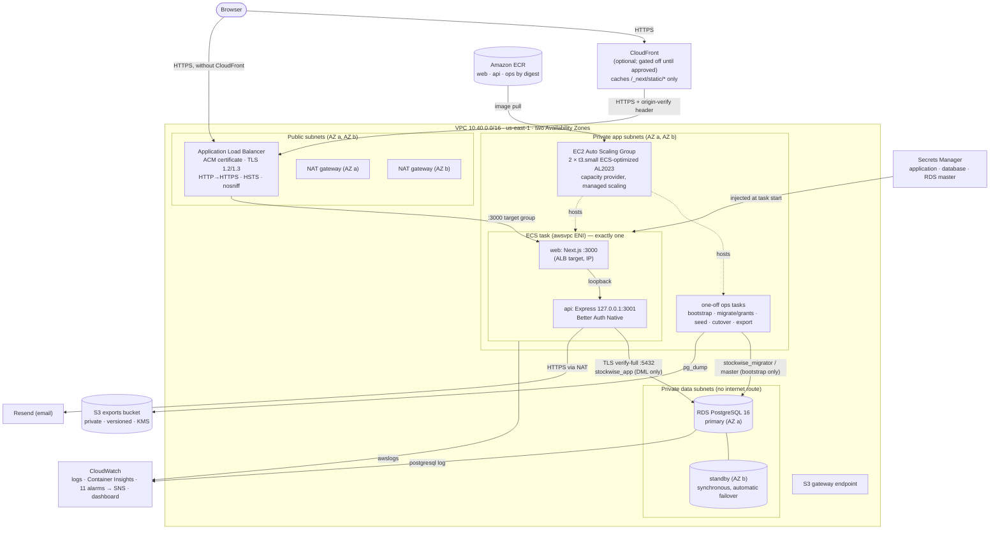

# StockWise on AWS — demo architecture (ADR-040)

Restores the original Cloud Computing project design on AWS Academy Learner Lab
for the demonstration window ending 2026-10-31 23:59 Asia/Bangkok. Synthetic
data only. Real production hosting remains open (`OQ-015`/`OQ-020`).

## Request path

1. The browser connects over HTTPS to the ALB, or to CloudFront if it is enabled.
2. The ALB terminates TLS with the ACM certificate, adds HSTS and `nosniff`, and forwards to the single task's IP on port 3000.
3. Next.js serves pages and proxies `/api/health` and `/api/v1/*` to the Express API over the task's own loopback interface. Both server log streams pass through the infrastructure redactor before CloudWatch ingestion; R3 covers query punctuation, encoded forms, CR and explicit line continuations.
4. The API reads and writes PostgreSQL as `stockwise_app` over TLS (`verify-full`).
5. Sessions are opaque database rows carried in an HttpOnly, Secure, SameSite=Lax, host-only cookie.

## Service by service

| Service | What it does here | Why it is real, not decorative |
| --- | --- | --- |
| **VPC** | Three subnet tiers in two AZs: public (ALB, NAT), private app (EC2/ECS), private data (RDS, no route out). An S3 gateway endpoint carries ECR layers and exports. | Network isolation is the security boundary: the database is unreachable from the internet. |
| **Security groups** | Internet (or CloudFront prefix list) → ALB :443 → task :3000 → RDS :5432. Container instances accept nothing inbound. | Each hop allows only the next hop's port and source. |
| **NAT gateways (2)** | One per AZ. Task ENIs have no public IP, so outbound calls to Resend, and the ECS agent's calls to AWS APIs, leave through the NAT in their own AZ. | Losing one AZ does not cut the other AZ's egress. |
| **Application Load Balancer** | Internet-facing in both public subnets. HTTPS listener (ACM, TLS 1.2/1.3 policy), HTTP→HTTPS redirect, response-header controls, IP target group health-checked on `/api/health`. Request logging is deliberately off: ALB access logs would record the `?token=` query strings of emailed links (F1). | Replaces Caddy. It checks the web container, its rewrite and the API together. |
| **ACM** | DNS-validated certificate for the demo hostname. With CloudFront, the same us-east-1 certificate serves both. | TLS with managed renewal, no private keys on hosts. |
| **CloudFront** (optional, gated off) | Edge HTTPS. Caches only content-hashed `/_next/static/*`. Pages and APIs are uncached and forward all headers, cookies and query strings. The ALB then accepts only CloudFront origin addresses plus a secret header. | Matches the original diagram without risking cached user data. Terraform refuses to enable it until the owner approves the origin secret being stored in plaintext in Terraform state (F4), or a secret-free design. Lab access is also unverified. |
| **EC2 Auto Scaling Group** | Two ECS-optimized AL2023 t3.small instances, one per AZ (max 3). IMDSv2 only, `LabInstanceProfile`, no SSH; administration through SSM. Scheduled scale-to-zero at the deadline. | Provides the capacity in both AZs that ECS places tasks on. |
| **ECS (EC2 capacity provider)** | A cluster with managed scaling on the ASG. One service runs exactly one task (web + api, `awsvpc`), with circuit-breaker rollback. One-off ops tasks handle database work. | Real orchestration: placement across AZs, health-based replacement, rolling to new digests. |
| **ECR** | Immutable, scan-on-push repositories for `web`, `api` and `ops`. The operator copies CI-built images by digest. | Images come from inside AWS. Task definitions accept digests only. |
| **RDS PostgreSQL Multi-AZ** | db.t4g.micro primary with a synchronous standby in the other AZ. Encrypted gp2, private, TLS forced, automated backups, PostgreSQL logs to CloudWatch. | Survives an AZ or instance failure with automatic failover. |
| **Secrets Manager** | `application` (app keys, Resend key), `database` (role passwords), and the RDS-managed master secret. Values are generated by the operator and injected per key by ECS. | No secret in Git, images, Terraform state or logs. Each task gets only its own keys. |
| **S3** | Exports bucket for `pg_dump` exports: private, versioned, KMS, TLS-only. | Logical backups that teardown verifies and downloads before deletion. There is deliberately no ALB access-log bucket (F1). |
| **CloudWatch** | Container logs (7 days), Container Insights, RDS logs, 11 alarms to SNS, one dashboard. The `web` and `api` logs pass through an in-image redaction boundary first: query strings and credential-shaped values are removed, because Next.js proxy failures print full upstream URLs (R2-F1). The outage alarm compares healthy targets with the ECS service's desired count, and resumes re-arm it (R2-F8). | Shows health, errors, latency, capacity and database load during the demonstration, without storing the credentials that emailed links carry. |
| **IAM** | No IAM resources are created (Learner Lab forbids it). `LabRole` is the ECS execution role and the export task's role. The application task has no role. | A documented, compensated exception (ADR-040). |

## Availability, honestly

- **Database:** tolerates the loss of one AZ (Multi-AZ failover, typically one to two minutes).
- **Compute capacity:** exists in both AZs.
- **Application:** exactly one task, because the login limiter is process-local.
  - A failed task or instance means an outage until ECS starts a replacement on the other AZ's instance.
  - Every release also has a short outage, because the old task stops before the new one starts.
  - The configuration is **not fully highly available**.
- **Scaling to several tasks** first requires a PostgreSQL-backed shared limiter (a separate security task in ADR-040). The ASG's scaling is EC2 capacity scaling, not application-replica scaling.
